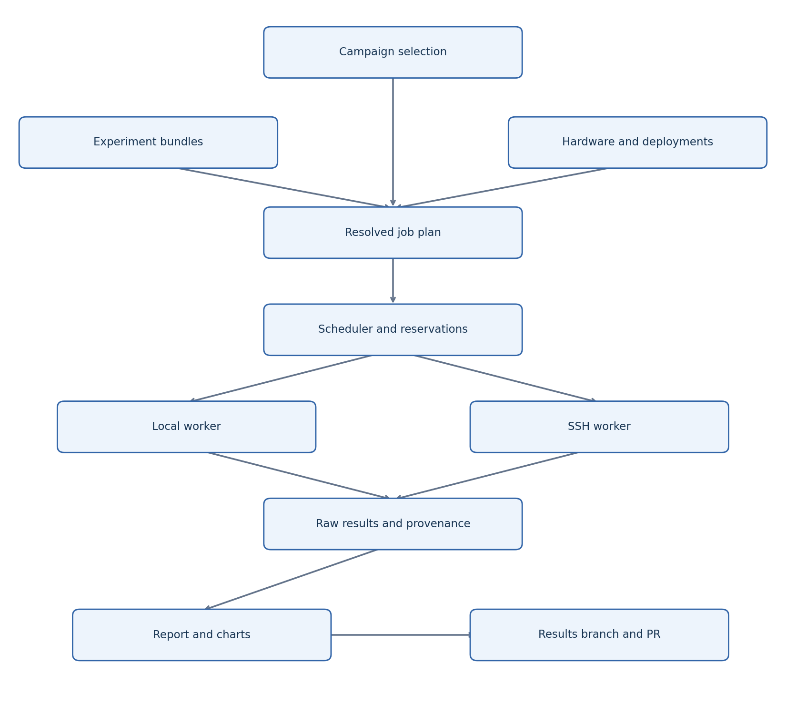

# llm-eval

A reproducible lab for running **versioned LLM experiments** across hardware configurations, operating systems, inference platforms, and explicitly configured hosted models. Campaigns select one or more experiments and execute their cases serially or in parallel on independent resources.

## Contents

| Topic | Documents |
|---|---|
| Summary | [Executive summary](#executive-summary): recommended models per platform, experiment and hardware configuration |
| Experiments | [Hardware fit](experiments/hardware-fit/README.md) · [Model offloading](experiments/model-offloading/README.md) · [Decision models](experiments/decision-models/README.md) · [Legal benchmark](experiments/legal-benchmark/README.md) ([walkthrough](docs/LEGAL_BENCHMARK_WALKTHROUGH.md)) · [Add a new experiment](docs/NEW_EXPERIMENT.md) |
| Models | [Model catalog](docs/MODELS.md) · [Model origins and US models](docs/MODELS.md#model-origins) · [Candidate models from Ollama, Hugging Face and LM Studio](docs/MODEL_CANDIDATES.md) · [LiveBench integration](docs/LIVEBENCH.md) · [Nightly model discovery](docs/MODEL_DISCOVERY.md) · catalogs: [models](catalog/models.json), [artifact pins](catalog/model-artifacts.json), [origins](catalog/model-origins.json) |
| Model platforms | [Setup and compatibility of every platform](docs/PLATFORMS.md): [Ollama](docs/PLATFORMS.md#ollama) · [LM Studio](docs/PLATFORMS.md#lm-studio) · [KoboldCpp](docs/PLATFORMS.md#koboldcpp) · [llama.cpp and ik_llama.cpp](docs/PLATFORMS.md#llamacpp-and-ik_llamacpp) · [KTransformers](docs/PLATFORMS.md#ktransformers) · [vLLM](docs/PLATFORMS.md#vllm) · [Hugging Face Accelerate](docs/PLATFORMS.md#hugging-face-accelerate) · [AirLLM](docs/PLATFORMS.md#airllm) · [Strata](docs/PLATFORMS.md#strata) |
| Hardware configurations | [Hardware configurations](docs/HARDWARE.md): [raider-windows](docs/HARDWARE.md#raider-windows) · [raider-wsl](docs/HARDWARE.md#raider-wsl) · [raider-ubuntu](docs/HARDWARE.md#raider-ubuntu) |
| Running experiments | [Readiness checker](docs/READINESS.md) · [Campaigns, inventories, SSH and recovery](docs/CAMPAIGNS.md) · walkthroughs for [native Windows 11](docs/WINDOWS_RAIDER_WALKTHROUGH.md), [WSL2 / Ubuntu 26.04](docs/WSL_RAIDER_WALKTHROUGH.md) and [native Ubuntu 26.04](docs/UBUNTU_RAIDER_WALKTHROUGH.md) · [Original platform workflows](docs/WORKFLOWS.md) |
| Results | [Experiment results](docs/results/README.md) · [Results index](docs/results/index/README.md) · [Recommended setups](docs/results/index/recommended/README.md) · [Report generation and results pull requests](docs/RESULTS.md) |
| Reference | [Methodology](docs/METHODOLOGY.md) · [Validation record](docs/VALIDATION.md) · [Security](docs/SECURITY.md) |

## Experiments

| Experiment | What it evaluates | Guide |
|---|---|---|
| Hardware fit | The best model artifact for a hardware configuration that stays inside GPU VRAM: projected fit of candidate artifacts from GPU, VRAM, CPU, RAM and disk limits, and measured runs with every layer on the GPU | [Hardware fit guide](experiments/hardware-fit/README.md) |
| Model offloading | Quality, latency, throughput, and CPU/GPU/disk placement for models exceeding GPU VRAM | [Original experiment and model catalog](experiments/model-offloading/README.md) |
| Decision models | Accuracy and latency of decision models (one choice question per task over named criteria, through Ollama's SystemOne API), replay selection quality, and the live quality, latency and API cost of the generators they route to. Formerly `llm-routing` | [Decision models guide](experiments/decision-models/README.md) |
| Legal benchmark | Retrieval of applicable law and source-grounded draft screening memos for human review, over a fictional jurisdiction; fictional fixture suite only; four runs on the Windows host and four in WSL2 published (generation and workflow on a served model, score, fixture retrieval), human review pending | [Legal benchmark guide](experiments/legal-benchmark/README.md) |

The original target is the MSI Raider 18 HX AI with RTX 5090 Laptop 24 GiB, 64 GiB RAM, and native Ubuntu, native Windows, or WSL. Additional machines use their own profiles and execution targets. **Fixture tests are not real hardware benchmarks.** See the [validation record](docs/VALIDATION.md) for hardware acceptance gates.

## Executive summary

The recommended model on each model platform, per experiment and hardware configuration, from the published results. Decision models run only on Ollama, the one platform here with the SystemOne API. The legal benchmark publishes its results by class and cohort and does not rank models. On the MSI Raider, every US model measured so far is a model-offloading run: no US model has been measured in hardware fit, and every decision model measured so far is fine-tuned from a Qwen base, so none is a US model. The [candidate review](docs/MODEL_CANDIDATES.md) lists the US models to measure next.

<!-- summary-recommended:start -->

Generated by `llm-eval index-results` from the published bundles; do not edit between the markers. Each cell is the best-ranked model on that platform: checks passed and median wall time per request, linked to the report of its run, which records the run configuration. The second line is the best-ranked US model (developer and base models from the United States). "–" means no measured run with scored checks on that platform. The ranking is the one of the [results](docs/results/README.md); the [recommended setups](docs/results/index/recommended/README.md) pages give the configuration of the best-ranked run of each experiment and hardware configuration.

**[raider-wsl](docs/results/index/hardware/raider-wsl.md)**

| Experiment | Ollama | LM Studio | KoboldCpp |
|---|---|---|---|
| [Hardware fit](experiments/hardware-fit/README.md) | [qwen38-27b-ud-q4_k_xl](docs/results/index/model/qwen38-27b-ud-q4_k_xl.md) [24/27, 1.97 s](docs/results/hardware-fit/campaign-20261123T120632Z-53d7833d-fit-hardware-fit-1/README.md)<br>US: none measured | [qwen38-27b-ud-q4_k_xl](docs/results/index/model/qwen38-27b-ud-q4_k_xl.md) [24/27, 0.886 s](docs/results/hardware-fit/campaign-20261123T120632Z-53d7833d-fit-hardware-fit-1/README.md)<br>US: none measured | [qwen38-27b-ud-q4_k_xl](docs/results/index/model/qwen38-27b-ud-q4_k_xl.md) [24/27, 2.78 s](docs/results/hardware-fit/campaign-20261123T060454Z-d3e0de27-fit-hardware-fit-1/README.md)<br>US: none measured |
| [Model offloading](experiments/model-offloading/README.md) | [kimi-linear-48b](docs/results/index/model/kimi-linear-48b.md) [24/27, 0.149 s](docs/results/model-offloading/campaign-20261117T043857Z-d2cbbd81-offload-model-offloading-1/README.md)<br>US: [nemotron-nano-30b](docs/results/index/model/nemotron-nano-30b.md) [24/27, 2.71 s](docs/results/model-offloading/campaign-20261117T064606Z-ca04bbea-offload-model-offloading-1/README.md) | [qwen35-35b-moe](docs/results/index/model/qwen35-35b-moe.md) [27/27, 8.32 s](docs/results/model-offloading/campaign-20261122T083921Z-1f20982a-offload-model-offloading-1/README.md)<br>US: [nemotron-nano-30b](docs/results/index/model/nemotron-nano-30b.md) [24/27, 5.09 s](docs/results/model-offloading/campaign-20261122T003348Z-8d8d894b-offload-model-offloading-1/README.md) | [kimi-linear-48b](docs/results/index/model/kimi-linear-48b.md) [24/27, 0.524 s](docs/results/model-offloading/campaign-20261117T043857Z-d2cbbd81-offload-model-offloading-1/README.md)<br>US: [gemma4-26b-moe](docs/results/index/model/gemma4-26b-moe.md) [21/27, 0.524 s](docs/results/model-offloading/campaign-20261118T050451Z-60d1fe39-offload-model-offloading-1/README.md) |
| [Decision models](experiments/decision-models/README.md) | [llm-eval-tev1:locked](docs/results/index/model/llm-eval-tev1-locked.md) [6/6, 0.0253 s](docs/results/llm-routing/campaign-20261118T051019Z-d72bad77-routing-llm-routing-1/README.md)<br>US: none measured | – | – |
| [Legal benchmark](experiments/legal-benchmark/README.md) | – | – | – |

Published here but not ranked (fixture runs only, or results published by class and cohort): [Legal benchmark](experiments/legal-benchmark/README.md).

**[raider-windows](docs/results/index/hardware/raider-windows.md)**

| Experiment | Ollama | LM Studio | KoboldCpp |
|---|---|---|---|
| [Hardware fit](experiments/hardware-fit/README.md) | – | – | – |
| [Model offloading](experiments/model-offloading/README.md) | [kimi-linear-48b](docs/results/index/model/kimi-linear-48b.md) [24/27, 0.141 s](docs/results/model-offloading/campaign-20261115T140213Z-85f189ba-offload-model-offloading-1/README.md)<br>US: [nemotron-nano-30b](docs/results/index/model/nemotron-nano-30b.md) [24/27, 2.47 s](docs/results/model-offloading/campaign-20261115T172956Z-1be0350b-offload-model-offloading-1/README.md) | [kimi-linear-48b](docs/results/index/model/kimi-linear-48b.md) [24/27, 0.147 s](docs/results/model-offloading/campaign-20261115T140213Z-85f189ba-offload-model-offloading-1/README.md)<br>US: [nemotron-nano-30b](docs/results/index/model/nemotron-nano-30b.md) [24/27, 4.62 s](docs/results/model-offloading/campaign-20261115T172956Z-1be0350b-offload-model-offloading-1/README.md) | [kimi-linear-48b](docs/results/index/model/kimi-linear-48b.md) [24/27, 0.58 s](docs/results/model-offloading/campaign-20261115T140213Z-85f189ba-offload-model-offloading-1/README.md)<br>US: [gemma4-26b-moe](docs/results/index/model/gemma4-26b-moe.md) [21/27, 0.582 s](docs/results/model-offloading/campaign-20261115T161112Z-fff50610-offload-model-offloading-1/README.md) |
| [Decision models](experiments/decision-models/README.md) | [llm-eval-tev1:locked](docs/results/index/model/llm-eval-tev1-locked.md) [6/6, 0.0367 s](docs/results/llm-routing/campaign-20261115T130420Z-a4e6c761-routing-llm-routing-1/README.md)<br>US: none measured | – | – |
| [Legal benchmark](experiments/legal-benchmark/README.md) | – | – | – |

Published here but not ranked (fixture runs only, or results published by class and cohort): [Legal benchmark](experiments/legal-benchmark/README.md).

**[raider-ubuntu](docs/results/index/hardware/raider-ubuntu.md)**

No measured run with scored checks has been published for this hardware configuration yet.

<!-- summary-recommended:end -->

## Start here

Run the [readiness checker](docs/READINESS.md) on the test host to find missing tools/libraries and install supported prerequisites after prompting: `powershell -NoProfile -File .\scripts\readiness.ps1` on native Windows, or `bash scripts/readiness.sh` on Ubuntu/WSL. Use `--check-only` for an audit or `--campaign FILE` to derive requirements from your experiments.

For a complete combined model-offloading and decision-models campaign on the MSI Raider, choose your OS. Each walkthrough covers installation, model preparation, plan, setup, run, status, resume, reports and results PRs, with labeled example output.

| Platform | Walkthrough | Campaign files |
|---|---|---|
| Native Windows 11 | [PowerShell](docs/WINDOWS_RAIDER_WALKTHROUGH.md) | [raider-windows](configs/examples/raider-windows/) |
| WSL2 / Ubuntu 26.04 | [Bash with Windows host preparation](docs/WSL_RAIDER_WALKTHROUGH.md) | [raider-wsl](configs/examples/raider-wsl/) |
| Native Ubuntu 26.04 | [Bash](docs/UBUNTU_RAIDER_WALKTHROUGH.md) | [raider-ubuntu](configs/examples/raider-ubuntu/) |

```bash
python -m pip install -e ".[telemetry,reporting]"
python -m llm_eval experiments list
python -m llm_eval plan --campaign campaigns/routing-smoke.json
python -m llm_eval run --campaign campaigns/routing-smoke.json
```

The smoke campaign is a labeled synthetic decision-models fixture: a keyword category router, no model. It runs without model downloads or paid API calls and generates a local report. It does not publish a PR.

For the campaign wizard:

```bash
python scripts/setup.py --interactive
python scripts/run.py --interactive
```

For real experiments, copy and complete the [combined campaign example](campaigns/offload-and-routing.example.json), hardware inventory and experiment cases in `configs/local/`. The example enables automatic results PRs; configure GitHub credentials before publication. Inspect the plan before running it.

```bash
llm-eval plan --campaign configs/local/campaign.json
llm-eval setup --campaign configs/local/campaign.json
llm-eval run --campaign configs/local/campaign.json --max-parallel-jobs 1
llm-eval run --campaign configs/local/campaign.json --max-parallel-jobs 2
llm-eval status --campaign-dir results/campaign-EXAMPLE
llm-eval resume --campaign-dir results/campaign-EXAMPLE
```

Parallel jobs share a resource scheduler. Isolated measurements sharing a physical host run serially; Windows and WSL on the same laptop share one resource identity. Separate boot environments are resumed in their respective OS sessions. The harness does not reboot machines.



## Experiment results

The [results documentation](docs/results/README.md) contains reviewed experiment reports, raw measurement exports, JSON/CSV summaries and embedded PNG charts. Each experiment run can automatically generate and push a results branch and open a PR for review. Reports are merged using the repository's normal review process.

```bash
python scripts/report_experiment.py --experiment-dir results/campaign-EXAMPLE/experiments/EXPERIMENT_RUN --publish-pr
llm-eval publish-results --input results/campaign-EXAMPLE/experiments/EXPERIMENT_RUN/report --dry-run
```

## Documentation

Every document is listed under [Contents](#contents). The [legal benchmark walkthrough](docs/LEGAL_BENCHMARK_WALKTHROUGH.md) covers offload calibration, the locked serving profile, routing calibration and replay, the frozen legal evaluation and the local report.

Existing `llm-eval run --config FILE`, `scripts/run.py --config FILE`, and platform/OS wrappers remain supported. Their original installation and local-inference defaults remain in place. Source, workloads and experiment settings must be pinned for meaningful comparisons.
