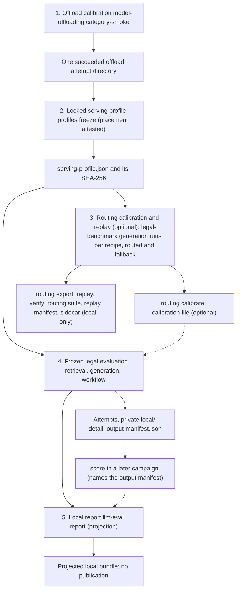

# Legal benchmark workflow

The five stages of the [legal benchmark walkthrough](../docs/LEGAL_BENCHMARK_WALKTHROUGH.md) and the explicit output of each. A phase dependency only orders jobs; the next stage names the output file in its case. Stage 3 is optional, and the frozen evaluation takes from it at most the calibration file (dashed edge).

[View PNG rendering](legal-benchmark-workflow.png).
