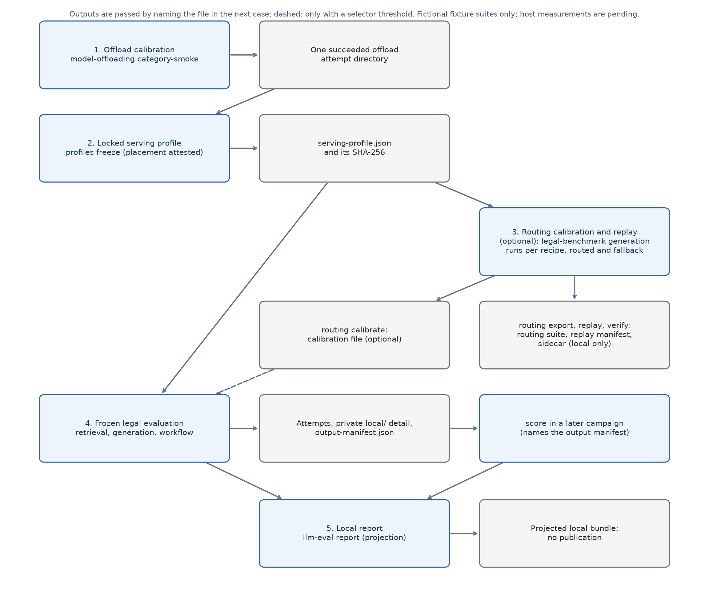

# Legal benchmark walkthrough

**Output provenance.** This walkthrough was written from the code of the `legal-benchmark` experiment and its tests. While writing it, these commands were run on a Windows development host, CPU only: the repository's unit tests (scripted loopback test servers stand in for every model), `llm-eval experiments list`, the read-only `llm-eval plan` of the example campaigns, `llm-eval matrix` with its output outside the checkout, and `scripts/render_legal_diagram.py`. No model was served, no GPU was used, and no campaign was set up or run on a target host. Every output block below is illustrative expected output, not a measurement: values in angle brackets are placeholders. Host measurements are pending.

The experiment drafts internal screening memos **for human review** over a **fictional jurisdiction with original authorities** (the "Commonwealth of Veld" fixtures). It never files, charges, contacts anyone or discloses evidence. The plan this walkthrough implements states the scope:

- No authorization to access private matter inputs or publish a results bundle is implied by this plan.
- Do not run models on actual prosecution decisions or automate filing, charging, contact or evidence disclosure.
- No public results promotion from private inputs, even aggregate metrics.
- Run one campaign at a time on the Raider.

The rules this page refers to are stated once, in the [experiment README](../experiments/legal-benchmark/README.md); this page quotes them or links to them.



## What this walkthrough runs

Three experiments take part: `model-offloading` (stage 1), `legal-benchmark` (stages 3 to 5) and, optionally, `llm-routing` (a replay in stage 3). Each stage pins its inputs by digest and writes an explicit output that a later stage names by file.

| Stage | Experiment and mode | Pinned input | Explicit stage output |
|---|---|---|---|
| 1. Offload calibration | `model-offloading`, `category-smoke` on the legal-shaped workload | `experiments/legal-benchmark/workloads/qualification/legal-shaped.json`, artifact lock | one succeeded attempt directory |
| 2. Locked serving profile | operator command `profiles freeze` with the observed placement attested | campaign directory, job id, attempt id (all explicit) | `serving-profile.json` and its SHA-256 |
| 3. Routing calibration and replay (optional) | on the calibration suite: `legal-benchmark` `generation` per recipe and one routed run, then `routing calibrate`; on the evaluation suite: `routing export`, `routing replay`, `routing verify`, then `llm-routing` `replay` or `routing evaluate` | both suite locks, locked profile | calibration file, routing suite, replay manifest, sidecar provenance |
| 4. Frozen legal evaluation | `legal-benchmark` `retrieval`, `generation`, `workflow` (with the pinned calibration file when a threshold is used), then `score` in a later campaign | suite lock, locked profile, calibration file (only with a threshold), output manifest | attempts with rows, private `local/` detail, output manifest |
| 5. Local report | `llm-eval report` | campaign directory | projected local bundle (exact fixture export for an approved fixture suite, reduced projection for any other suite); no publication |

A phase dependency (`depends_on`) only orders jobs inside one campaign; it passes nothing. The locked serving profile, the calibration file, the output manifest and the replay manifest are passed by naming the file in the next case, where a path key (`serving_profile`, `calibration_file`, `output_manifest`, `replay`, `suite`) makes the planner pin the file it names by digest. Nothing reads "the newest" result. The frozen evaluation takes from stage 3 at most the calibration file; the routing suite, replay manifest and sidecar serve the routing comparison only.

The shipped suites are two small, disjoint fixture splits: `original-smoke` (8 families, 16 matters, `split_id: smoke`) and `original-packets` (2 families, 4 matters, `split_id: calibration`). They exercise the code paths; they are not the 12 calibration and 24 evaluation matter families of the plan, which are not authored (see [What is not covered](#what-is-not-covered)).

## Before you start: the examples take the Raider host lock

The example files are in [`configs/examples/legal/`](../configs/examples/legal/): the stage files with a Windows 11 native inventory, and one directory per host OS ([`raider-windows`](../configs/examples/legal/raider-windows/), [`raider-wsl`](../configs/examples/legal/raider-wsl/), [`raider-ubuntu`](../configs/examples/legal/raider-ubuntu/)) with an inventory and the evaluation campaign. Every inventory names the target `raider` with `physical_host_id: raider`, exactly as the [generic Raider examples](../configs/examples/raider-windows/inventory.json) do, so a legal campaign and every other Raider campaign exclude each other. **`setup` and `run` of any of these campaigns reserve the `raider` host lock.**

What keeps a copied example from measuring anything by accident, as the code has it: every role's `model_revision` and `backend_version` is a `REPLACE_WITH_` value, so the `generation` and `workflow` jobs stop at `profiles.check_revisions` before their first request (`Record the exact loaded model revision before evaluating`), and every campaign has `"publish": {"mode": "none"}`. The `retrieval` phase is a fixture run and does run. Stage 1 is a real `model-offloading` campaign: `setup` of `qualification-campaign.json` installs the serving runtime its run file names, and `run` reserves the `raider` host lock before the run file's placeholders are refused. It belongs to the operator who owns the host, one campaign at a time.

Install the harness (`python -m pip install -e ".[telemetry,reporting]"`; the legal benchmark needs no further dependency) and run [readiness](READINESS.md#legal-benchmark-campaigns) on the target host. Then copy the whole directory `configs/examples/legal/` to `configs/local/legal/` (ignored by Git; the relative case and suite paths keep working at that depth) and edit only the copies. Below, `raider-HOST` stands for `raider-windows`, `raider-wsl` or `raider-ubuntu`. The qualification files at the top of the directory describe Windows 11 native; on another OS point `inventory.json` and the `os_id` of `legal-offload-run.json` at that host's hardware configuration.

Host locks: the coordinator's reservation always uses the default lock directory of the account that runs it and ignores the target's `lock_root` (`orchestration/scheduler.py`, `orchestration/setup.py`); the worker's reservation uses the target's `lock_root`. Across native Windows and WSL only the worker lock coordinates, and only when both inventories name the same physical directory: follow [Share the Windows physical-host reservation](WSL_RAIDER_WALKTHROUGH.md#share-the-windows-physical-host-reservation) for the WSL inventory's `lock_root`.

## 1. Offload calibration

Qualify the serving settings of the generator with `model-offloading` over the legal-shaped workload: every matter's full `lexical-eligible` draft prompt of `original-smoke`. Fill [`legal-offload-run.json`](../configs/examples/legal/legal-offload-run.json) with the exact model artifact and lock, backend version, chat template digest, tokenizer revision and placement, and record the operator attestation in its `hardware_attestation` (only `os_build`, `nvidia_driver` and `paging`, each one token, are read later; `paging` is `none` or `observed`).

```bash
llm-eval plan --campaign configs/local/legal/qualification-campaign.json
llm-eval setup --campaign configs/local/legal/qualification-campaign.json
llm-eval run --campaign configs/local/legal/qualification-campaign.json
```

The output of this stage is one succeeded attempt directory, `CAMPAIGN_DIR/experiments/RUN_ID/jobs/JOB_ID/ATTEMPT_ID`, with its job and attempt ids in `campaign.json`.

## 2. Locked serving profile

Freeze the profile from that one named attempt. The offload result has no observed placement, so the operator attests the placement that was observed (`--observed-placement`, written as `key=value` pairs such as the run file's `gpu_layers` and `threads`); without it the profile's probe is `inconclusive` (`placement_unobserved`) and cannot qualify a role. The output must lie outside any repository, attempt directory and any directory named `reports` or `model_judgment`.

```bash
python -m llm_eval.experiments.legal_benchmark.profiles freeze --campaign-dir CAMPAIGN_DIR --job-id JOB_ID --attempt-id ATTEMPT_ID --observed-placement OBSERVED_PLACEMENT --output PRIVATE_DIR/serving-profile.json
```

The command prints the SHA-256 of the profile it wrote. Illustrative output:

```text
<the SHA-256 of serving-profile.json, 64 hexadecimal characters>
```

The probe outcome is `passed`, `failed` (`job_not_succeeded`, `request_errors`, `paging_observed`, `placement_mismatch`, `memory_reserve_exceeded`) or `inconclusive` (`paging_unknown`, `placement_unobserved`, `all_responses_truncated`, `no_measured_requests`). **On Windows 11 native and in WSL the paging counters cannot show host paging, so a profile passes there only with the explicit operator attestation `hardware_attestation.paging`; the attested value is an attestation, not a measurement, and a profile that claims observed paging on either is refused.** The public metadata of every role bound to such a profile says `qualified_by_attestation: true`.

Bind a role to the profile by copying the file next to your case and naming it: `"qualification": {"serving_profile": "serving-profile.json"}`. The role's identity, placement and budgets must equal the profile's, and the profile's probe must be `passed`: see [Locked serving profile](../experiments/legal-benchmark/README.md#serving-profiles-routing-and-exports) for the complete binding rule.

## 3. Routing calibration and replay

This stage is optional. It needs the generator of stage 2 and, for a served selector, a `selector` role (`capability: decision`, `protocol: json`, local). The attempts it reads are `legal-benchmark` `generation` runs.

On the **calibration suite** (`original-packets`), run a `generation` case with a `selector` block and no threshold (`require_confidence: false`), and a `generation` case of its fallback arm. Then calibrate a threshold:

```bash
python -m llm_eval.experiments.legal_benchmark.routing calibrate --suite experiments/legal-benchmark/workloads/original-packets/suite.lock.json --routed-attempt ROUTED_ATTEMPT_DIR --fallback-attempt FALLBACK_ATTEMPT_DIR --fallback-arm FALLBACK_ARM --thresholds THRESHOLDS --output PRIVATE_DIR/calibration.json
```

A case that uses a threshold names the record, the calibration suite and both output manifests in `selector.calibration` (`calibration_file`, `suite`, `routed.output_manifest`, `fallback.output_manifest`); planning re-runs the calibration from those pinned attempts and refuses a record that differs.

On the **evaluation suite** (`original-smoke`), run one `generation` attempt over the candidate arms (recipes) with the same generator, then export, replay and verify:

```bash
python -m llm_eval.experiments.legal_benchmark.routing export --suite experiments/legal-benchmark/workloads/original-smoke/suite.lock.json --output PRIVATE_DIR/routing-suite.json
python -m llm_eval.experiments.legal_benchmark.routing replay --suite experiments/legal-benchmark/workloads/original-smoke/suite.lock.json --routing-suite PRIVATE_DIR/routing-suite.json --attempt ATTEMPT_DIR --candidates PRIVATE_DIR/candidates.json --output PRIVATE_DIR/replay.json
python -m llm_eval.experiments.legal_benchmark.routing verify --suite experiments/legal-benchmark/workloads/original-smoke/suite.lock.json --replay PRIVATE_DIR/replay.json --routing-suite PRIVATE_DIR/routing-suite.json --candidates PRIVATE_DIR/candidates.json --attempt ATTEMPT_DIR
python -m llm_eval.experiments.legal_benchmark.routing evaluate --suite experiments/legal-benchmark/workloads/original-smoke/suite.lock.json --strategies PRIVATE_DIR/strategies.json --replay PRIVATE_DIR/replay.json --routing-suite PRIVATE_DIR/routing-suite.json --attempt ATTEMPT_DIR --candidates PRIVATE_DIR/candidates.json
```

`replay` also writes the sidecar `PRIVATE_DIR/replay.provenance.json`. The `--candidates` file maps each arm to exactly the fixed generator's identity. An illustrative `candidates.json` (every value a placeholder):

```json
{
  "lexical-eligible": {"model": "MODEL_ID", "model_revision": "EXACT_REVISION", "platform": "PLATFORM", "backend_version": "EXACT_VERSION", "protocol": "PROTOCOL", "quantization": "QUANTIZATION", "template_sha256": "TEMPLATE_SHA256", "context_tokens": "CONTEXT_TOKENS"},
  "no-context": {"model": "MODEL_ID", "model_revision": "EXACT_REVISION", "platform": "PLATFORM", "backend_version": "EXACT_VERSION", "protocol": "PROTOCOL", "quantization": "QUANTIZATION", "template_sha256": "TEMPLATE_SHA256", "context_tokens": "CONTEXT_TOKENS"}
}
```

- Exports, replays and calibrations exist only for a suite listed in [`approved-suites.json`](../experiments/legal-benchmark/approved-suites.json) (the two shipped fixture suites); any other suite gets `Export is limited to approved fixture suites`.
- `routing verify` must pass before a replay campaign: the routing experiment itself checks only the suite hash, the candidate fingerprints and duplicates. Then fill [`routing-replay-case.json`](../configs/examples/legal/routing-replay-case.json) and plan [`routing-replay-campaign.json`](../configs/examples/legal/routing-replay-campaign.json).
- Replay manifests, sidecars and calibration records hold per-matter values derived from the gold. They are local operator files and never public.
- A routing or offload report built from a legal export is refused by `publish-results` when it carries a legal benchmark name (`Publication identity mismatch: the bundle carries a legal benchmark name`) or legal content the plugin recognises (`Publication identity mismatch: the bundle carries content of legal-benchmark (<class>)`). The legal benchmark names are the plugin's own (`legal-smoke`, `legal-routing`, `legal-shaped` and the benchmark ids of approved suites); a public legal benchmark such as `LegalBench` under a generic experiment is publishable. The content check has a stated limit: a replay export with renamed ids and a foreign `suite_sha256` is not recognised (see [Known limits](VALIDATION.md#known-limits)).
- With the shipped data a threshold is calibrated on `original-packets` (2 families) and used on `original-smoke`; nothing calibrated on them supports adopting a selector.

## 4. Frozen legal evaluation

In your copy, fill the role identities of `generation-case.json` and `workflow-case.json` from the locked profile, bind each role to it, then plan and run. The campaign has three phases: `retrieval` (a fixture run of the lexical arms), `generation` and `workflow`.

```bash
llm-eval plan --campaign configs/local/legal/raider-HOST/legal-evaluation-campaign.json
llm-eval setup --campaign configs/local/legal/raider-HOST/legal-evaluation-campaign.json
llm-eval run --campaign configs/local/legal/raider-HOST/legal-evaluation-campaign.json
```

`setup` installs nothing for a legal campaign (only `serving: managed` would need a runtime, and it is gated). Each generation or workflow attempt writes `requests.jsonl` and `metadata.json` (public rows), the private files under `local/` and, last, `local/output-manifest.json` (see [What stays local](../experiments/legal-benchmark/README.md#what-stays-local)). When the attempt finishes, the coordinator records a receipt in `campaign.json`: `file_sha256` and `output_manifest_sha256` (see [Lineage](../experiments/legal-benchmark/README.md#classification-gates-and-the-report-projection)).

To grade the stored outputs again, write a review packet, have it reviewed (see the [checklist](#human-rubric-review-checklist)), and run `score` in a later campaign whose case names the output manifest (and optionally `review_file` with `review_key`):

```bash
python -m llm_eval.experiments.legal_benchmark.grading packet --output-manifest ATTEMPT_DIR/local/output-manifest.json --output PRIVATE_DIR/review
llm-eval plan --campaign configs/local/legal/score-campaign.json
llm-eval run --campaign configs/local/legal/score-campaign.json
```

A source attempt whose output manifest differs from the coordinator's receipt is refused (`Output manifest differs from the campaign record`), and one from a campaign written before the receipts existed too (`Campaign record has no output-manifest digest (campaign written before this check)`). The README states the consequence:

> An attempt in a campaign written before this package therefore cannot be scored, replayed or used for calibration in place (copy it out, or re-run it); a smoke campaign of that age still resumes and gets its local report, and cannot be published.

## 5. Local report

With `"on_experiment_end": true` the coordinator writes the report when an experiment's jobs end; build it again by hand with:

```bash
llm-eval report --input CAMPAIGN_DIR/experiments/RUN_ID
```

The report directory `CAMPAIGN_DIR/experiments/RUN_ID/report/` holds `publication.json` and `bundle/`; the seven bundle files (`README.md`, `manifest.json`, `summary.json`, `summary.csv`, `resolved-config.json`, `legal-summary.json` and `raw/measurements.jsonl.gz`) are under `bundle/docs/results/legal-benchmark/PUBLICATION_ID/`. What the projection exports is stated in the README:

> A legal report is the projection, never the generic scan: a strict recursive allowlist of enumerated categories, opaque ids, hashes, versioned numbers, approved settings, coverage and coarse status.

Nothing is published: see [Results](RESULTS.md#legal-benchmark-reports).

## Status, resume and cancel

```bash
llm-eval status --campaign-dir CAMPAIGN_DIR
llm-eval resume --campaign-dir CAMPAIGN_DIR
llm-eval resume --campaign-dir CAMPAIGN_DIR --retry-failed
llm-eval cancel --campaign-dir CAMPAIGN_DIR
```

`status` prints `campaign.json`. `cancel` writes `cancel.json`; the running coordinator stops the active attempts. `resume` continues an interrupted campaign; `--retry-failed` also retries failed jobs. Every start of `run` and `resume` first re-checks the harness revision, every pinned input against its planned digest (`Campaign input changed; create a new campaign`, or an `OSError` such as `FileNotFoundError` for a removed file) and the digest of its stored plan (`Campaign plan changed; create a new campaign`). An illustrative excerpt of `status` for a job the data policy refused:

```text
"jobs": {
  "<job id>": {"status": "failed", "reason": "data_policy", "attempts": []}
},
"reports": {
  "<experiment run id>": {"status": "disabled", "reason": "<classification reason>", "result_signature": "<digest>"}
}
```

A `failed` job with reason `data_policy` was refused by the scheduler before any attempt was journaled: no attempt directory, reservation or worker call exists for it. A suite lock removed or changed after planning is caught earlier, at the start of `run` or `resume`, by the input check above; `data_policy` appears when the pinned suite stops classifying as admissible while the campaign runs. Fix the input and create a new campaign; retrying cannot change the classification of the planned bytes. A report entry `disabled` with a classification reason means no bundle was written; the attempt files stay untouched.

## Roles

| Role | Capability | Protocol | Used by |
|---|---|---|---|
| `generator` | `chat` | `openai` or `ollama` | `generation`, `workflow` (required) |
| `analyst` | `chat` | `openai` or `ollama` | `workflow` (optional; without it the generator deployment analyses) |
| `embedder` | `embedding` | `json` | the `dense` and `hybrid` retrieval arms |
| `reranker` | `rerank` | `json` | the `reranked` retrieval arm |
| `selector` | `decision` | `json` | a `systemone` selector router |

Every role is a role profile with an explicit `serving`: `external` (a local server the operator runs) is the only served mode; `in-process` exists only for the fixture embedder `fixture-hash` and reranker `fixture-overlap`; `managed` is recognised and refused (`Managed serving of legal roles is gated`). Every endpoint must be local: a `hosted` or remote network is refused (`Legal roles must be local`), so the hosted decision arm does not exist (both are listed under [What is not covered](#what-is-not-covered)). Requests go only to the endpoints of the planned job's roles that a requested arm uses. The role digest covers the profile without the endpoint, network, credentials and timeouts, and includes the bound serving profile. A role bound to a locked serving profile is `qualified: true` in the metadata with `serving_profile_sha256`; a role with `"qualification": null` is unqualified, and its results are not comparable with a qualified run (the cohort digest differs).

Roles may share a deployment; role, model and deployment identities stay separate. During first acceptance keep a single active large model per Raider: this is an operator rule, and the software does not refuse two deployments on one host (a served selector beside the generator breaks it). A role served on another physical host names it in `resource_host`, still uses a loopback endpoint (a local forward), and must be reserved by the job (`Role host is not reserved by this job`); see [A role on another host](../configs/examples/legal/README.md#a-role-on-another-host).

## Source permissions

Ingestion sorts every source into one of four namespaces (`evidence`, `authority`, `prior_brief`, `template`) and one of four source sets: `candidate` (`matters.json` and `corpus.json`), `oracle` (`oracle.json`), `review` (`review.json`) and `grader` (`rubric.json`, with every gold label and the reviewed reference passages). The suite lock pins each set under its own purpose.

| Reader | Candidate set | Reference passages (from the grader set) | Grader set (gold) | Oracle and review sets |
|---|---|---|---|---|
| Ordinary arms (`filters-only`, `lexical`, `lexical-eligible`, `dense`, `hybrid`, `reranked`) | through retrieval only | no | no | no |
| `no-context` | the matter's own evidence, no authority | no | no | no |
| `reference` arm | `retrieve()` receives the candidate view, but the arm shows only the reference passages | yes, without any gold conclusion, label or element mapping | no | no |
| Verifier (`grading.verify`) | the passages shown to the model | no | no | no |
| Grader (`grading.grade`) | yes | yes | yes | no |
| Human reviewer | the review packet: per item the `matter_id`, the output and its critical codes | no | the pilot rubric, outside the code | no |

Candidate-side code receives only `contracts.candidate_view(suite)`: the lock (listing only the matter and corpus files), its digest, the corpus and the matters, without the rubric. A prior brief is shown only through retrieval and never for the matters it excludes. The oracle and review sets are pinned and loaded with the suite, and no mode shows them to a model.

## Trust boundaries

- **Documents and model output are data.** Matter text, corpus text, emails and every model reply are untrusted content: passage text is fenced between `<<<BEGIN id>>>` and `<<<END id>>>` lines, no tool is offered and a reply that calls one is refused (`tool_call_refused`), and memos are rendered from validated JSON with every string escaped once.
- **Plan reads and hashes only.** `llm-eval plan` and validation read and hash local files; ingestion and dataset import are separate operator commands that `plan` never calls.
- **Endpoints.** A job's allowlist is computed from its planned roles; every legal role is local.
- **What stays local.** See [What stays local](../experiments/legal-benchmark/README.md#what-stays-local). The review packet and key, replay manifests, sidecars and calibration records are written outside the repository.
- **Classification.** One classification (`reporting.classify`) gives `approved`, `declared` or `refused`, with the reasons `approved`, `not_approved`, `private_matter`, `dataset_gate_blocked`, `unknown_mode`, `lock_missing`, `planned_digest_mismatch` and `lock_invalid`; the rule is in [One classification](../experiments/legal-benchmark/README.md#classification-gates-and-the-report-projection). The README states what each level allows:

  > `approved` allows local and SSH runs, collection and a local report, and, with an authorization, manual publication; `declared` allows a local run and a local, reduced report, and nothing leaves the host; `refused` allows nothing.

- **The six gates and the messages an operator meets.** The rule is in [The gates](../experiments/legal-benchmark/README.md#classification-gates-and-the-report-projection); the messages are the code's:

  | Gate | What the operator sees |
  |---|---|
  | Plan time | `Job is not admitted by the data policy of <job>: <reason>`; `Remote execution is not available for <job>: <reason>` for an SSH target that is not approved; `Publication is not available for legal-benchmark: automatic_publication_unavailable` for `publish.mode: pull-request` |
  | Scheduler | the job `failed` with reason `data_policy` |
  | Worker | `Data policy refused the job` |
  | Remote collection | `collect: refused` in the attempt record; `Collection refused by data policy: <path of the deciding job.json>` |
  | Finalization | report `disabled` with the reason, or `failed` with `ProjectionRejected` |
  | Publication | `Publication is not available for legal-benchmark: <code>` with the codes of `reporting.verify_publication`, in order: `provenance_missing`, `legacy_report`, `plan_changed`, `unverified`, `not_approved`, `not_approved_upstream`, `receipt_mismatch`, `bundle_mismatch`, `not_authorized` |

- **Small cohorts.** The rule (`MIN_COHORT`: fewer than 5 distinct matters publish no number outside an exact fixture export) is in [Small cohorts](../experiments/legal-benchmark/README.md#classification-gates-and-the-report-projection). Its limit, as the README states it:

  > Differencing is not prevented: two reduced runs over overlapping subsets (five matters and the same five plus a sixth) can be subtracted to give the sixth matter's result.

- **Publication.** Manual publication needs `publication-authorization.json`, which `python -m llm_eval.experiments.legal_benchmark.reporting authorize` writes only after the run id is typed back on an interactive terminal; no legal bundle has been published, and nothing in this repository runs `authorize`. See [Publication](../experiments/legal-benchmark/README.md#classification-gates-and-the-report-projection).

  > A report manifest's own labels authorize nothing.

- **Private matter.** Every mode refuses `data_class: private-matter` at plan time (`This mode does not accept private-matter suites`).

  > Private matter is never transferred or published in any form; the class exists so that every gate can refuse it.

The threat model, as the [README](../experiments/legal-benchmark/README.md#classification-gates-and-the-report-projection) states it:

> The gates stop mistakes, lazy relabels and partial edits by an operator, and let no unapproved or private suite's numbers out through this code without a deliberate forgery of several files. They do not stop a person who rewrites every file by hand.

> Review of the publication pull request is the remaining control.

## Human rubric review checklist

For a qualified legal reviewer, once per reviewed memo. The reviewer works from `review-packet.json` and never sees `review-key.json`. The packet is blind to the arm, model and deployment and to the order (item ids are drawn at random; the order is secret), not to the matter: each item carries its `matter_id`. Every box stays empty until the review is done; nothing in this repository records a completed review.

- [ ] The gold rubric entry of the matter is confirmed (recommendation, elements, conflicts, missing information, adverse authority).
- [ ] The authority snapshot and the effective date of each cited version are confirmed for the matter's operative date and venue.
- [ ] Each claim marked `supported` is entailed by its cited pinpoint (`semantic_entailment`).
- [ ] The admissibility of the evidence relied on is assessed (`admissibility`).
- [ ] Defense arguments and adverse evidence are fairly stated (`defense_arguments`).
- [ ] The analysis is sufficient for the proposed disposition (`sufficiency`).
- [ ] Every critical error of the item is adjudicated: one `adjudications` entry per critical code, `upheld: true` (the error stands) or `upheld: false` (dismissed).
- [ ] The review is recorded as a review file for the packet: `kind: legal-review`, `reviewer` with `kind: human` and `blind: true`, verdicts and adjudications keyed by packet `item_id`, the packet's `packet_sha256` and the `rubric_version`.
- [ ] The reviewer is identified by a random `reviewer_token` (32 hexadecimal characters) from the operator's local registry, never by a name, an address or a hash of one.

Until such a review is scored, the four semantic dimensions (`semantic_entailment`, `admissibility`, `defense_arguments`, `sufficiency`) stay `pending`, and a row with a critical error stays `pending_human_review`. An illustrative review file (placeholders throughout):

```json
{
  "schema_version": 1,
  "kind": "legal-review",
  "reviewer": {"kind": "human", "reviewer_token": "<32 random hexadecimal characters>", "blind": true},
  "rubric_version": "original-smoke-rubric-2",
  "packet_sha256": "<the packet digest from review-key.json>",
  "verdicts": [{"item_id": "<16 hexadecimal characters>", "dimension": "semantic_entailment", "verdict": "pass", "critical": false}],
  "adjudications": [{"item_id": "<16 hexadecimal characters>", "code": "wrong_version", "upheld": true}]
}
```

## Repeatable acceptance command sequence

Software acceptance on a development host. Installing the harness needs network access and is the operator's step:

```bash
python -m pip install -e ".[telemetry,reporting]"
```

The sequence itself is offline, CPU only and runs no model. Write the matrix outside the checkout (`OUTSIDE_DIR`):

```bash
python -m unittest tests.test_legal_examples tests.test_upstream_pins tests.test_readiness tests.test_workflows
python -m llm_eval experiments list
python -m llm_eval plan --campaign campaigns/legal-smoke.json
python -m llm_eval plan --campaign configs/examples/legal/raider-windows/legal-evaluation-campaign.json
python -m llm_eval matrix --output OUTSIDE_DIR/matrix.csv
python -m unittest discover -s tests -v
```

`experiments list` shows the five legal modes; both plans print and create no file; the full suite ends with `OK`. The result of this sequence on the development host is recorded in [VALIDATION.md](VALIDATION.md#legal-benchmark-issue-45).

Target-host sequence, per host cell, one campaign at a time on the Raider. **Not run in this effort.** `setup` and `run` reserve the `raider` host lock.

```bash
bash scripts/readiness.sh --campaign configs/local/legal/raider-HOST/legal-evaluation-campaign.json --json-output OUTSIDE_DIR/readiness-legal.json
llm-eval plan --campaign configs/local/legal/qualification-campaign.json
llm-eval setup --campaign configs/local/legal/qualification-campaign.json
llm-eval run --campaign configs/local/legal/qualification-campaign.json
python -m llm_eval.experiments.legal_benchmark.profiles freeze --campaign-dir CAMPAIGN_DIR --job-id JOB_ID --attempt-id ATTEMPT_ID --observed-placement OBSERVED_PLACEMENT --output PRIVATE_DIR/serving-profile.json
llm-eval plan --campaign configs/local/legal/raider-HOST/legal-evaluation-campaign.json
llm-eval setup --campaign configs/local/legal/raider-HOST/legal-evaluation-campaign.json
llm-eval run --campaign configs/local/legal/raider-HOST/legal-evaluation-campaign.json
llm-eval status --campaign-dir CAMPAIGN_DIR
llm-eval report --input CAMPAIGN_DIR/experiments/RUN_ID
```

On native Windows run readiness with `powershell -NoProfile -File .\scripts\readiness.ps1` and the same options. The target-host checklist is in [VALIDATION.md](VALIDATION.md#target-host-acceptance).

## What is not covered

This walkthrough makes no model quality claim and no hardware performance claim. It uses no real jurisdiction: the built-in policy is the fictional fixture policy, and any other corpus needs a counsel-supplied policy profile and does not load without one. It uses no private data and publishes nothing.

These plan requirements stay gated. Each names the package that gates it and what lifts it; the same list, with the plan's sentence and the reasons, is in [VALIDATION.md](VALIDATION.md#gated-plan-requirements).

- Managed serving of legal roles: gated by package C (`profiles.MANAGED_SERVING_ENABLED` is `False`). Lifted by a reviewed change that binds a role's launch settings to the shared launcher and flips the constant. Settled by the integration owner: the gate stays.
- The hosted decision arm: package E; every legal role is local. Lifted by an approved-list entry with an explicit off-host flag (a reviewed change) and a pinned selector role.
- Tev1 and Nimble selectors: package E; need served selectors after protocol and memory qualification on the host.
- A generator comparison and a verifier cascade: package E; need measured candidates. No verifier cascade is built.
- Real DOCX, PDF and OCR backends: package B; no backend is pinned in `capabilities.json`, so such files are `unsupported` and scanned pages block the lock.
- A real public dataset import with its five gates (`bytes`, `license`, `jurisdiction`, `split`, `grader_parity`): package B; nothing is downloaded, and an operator verifies each gate on real local bytes.
- The eCFR, LegalReasonBench and Harvey adapters: package B; registered and gated, their release formats cannot be verified offline.
- The 12 calibration and 24 evaluation matter families: package B and the qualified legal reviewer; their gold rubric is the pilot rubric. Settled by the integration owner: the two small splits ship, these sets stay gated.
- A counsel-supplied policy profile for a real jurisdiction: package C; none is shipped.
- Validated human or judge scoring: package D; the four semantic dimensions stay `pending` until a validated review exists, and no judge model is called.
- Publication of any legal result bundle: package F; needs a separately authorized step and a reviewed pull request.
- Any private pilot: a separate decision with its own operator and counsel approval.
