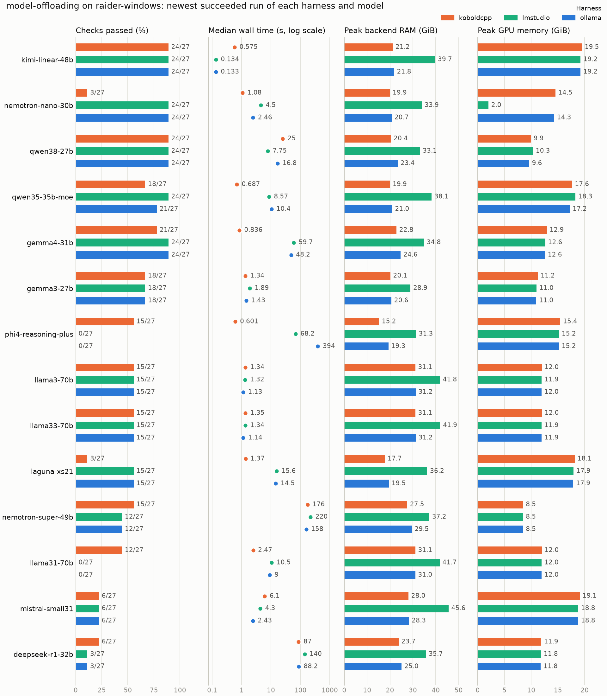
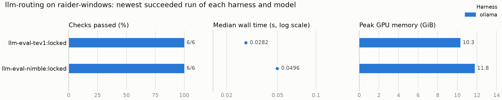

# Experiment results

Results of the llm-eval experiments on the hardware configurations measured so far. The page opens with the **executive summary**: the three best harness and model combinations per experiment for each hardware configuration, a comparison chart for each, and the conclusions per hardware configuration. After it come the navigation index (by hardware configuration, experiment, harness, model and date), the detailed results by experiment, harness and model, the tooling issues observed, and the list of every published report.

Tables and charts between `results-*` markers are generated from the published bundles by `llm-eval index-results`; everything else is operator-written. Results are listed newest first: experiments by their newest result, models within a harness by their newest run, and runs within a table by date. Figures are medians over measured (non-warmup) requests unless stated otherwise. Each linked report includes raw measurements, summaries, its own latency chart and reproducibility metadata. Synthetic fixtures are explicitly labeled.

## Executive summary

<!-- results-top:start -->

### Top 3 harness and model combinations per experiment and hardware configuration

Ranked by share of checks passed (correct decisions for routing experiments, quality checks otherwise), then lower median wall time per request, then higher output tokens per second. Each harness and model combination is represented by its newest measured run that succeeded; synthetic fixtures, failed runs and runs without scored checks are not ranked. Wall time and token rate are the median of the category medians.

**[model-offloading](index/experiment/model-offloading.md) on [raider-windows](index/hardware/raider-windows.md)**

| Rank | Harness | Model | Checks passed | Median wall s | Output tok/s | Run |
|---:|---|---|---:|---:|---:|---|
| 1 | [ollama](index/harness/ollama.md) | [kimi-linear-48b](index/model/kimi-linear-48b.md) | 24/27 | 0.133 | 17 | [2026-11-10 cap 2048](model-offloading/campaign-20261110T111300Z-172c453b-offload-model-offloading-1/README.md) |
| 2 | [lmstudio](index/harness/lmstudio.md) | [kimi-linear-48b](index/model/kimi-linear-48b.md) | 24/27 | 0.134 | 16.4 | [2026-11-10 cap 2048](model-offloading/campaign-20261110T111300Z-172c453b-offload-model-offloading-1/README.md) |
| 3 | [koboldcpp](index/harness/koboldcpp.md) | [kimi-linear-48b](index/model/kimi-linear-48b.md) | 24/27 | 0.575 | 3.52 | [2026-11-10 cap 2048](model-offloading/campaign-20261110T111300Z-172c453b-offload-model-offloading-1/README.md) |

Chart: every ranked combination, best-ranked model first, one color per harness. Each panel has its own axis; wall time is on a log scale. Exact values are in the tables of this page and in the linked reports.

**[llm-routing](index/experiment/llm-routing.md) on [raider-windows](index/hardware/raider-windows.md)**

| Rank | Harness | Model | Checks passed | Median wall s | Output tok/s | Run |
|---:|---|---|---:|---:|---:|---|
| 1 | [ollama](index/harness/ollama.md) | [llm-eval-tev1:locked](index/model/llm-eval-tev1-locked.md) | 6/6 | 0.0282 | – | [2026-11-08](llm-routing/campaign-20261108T035738Z-332b0246-routing-llm-routing-1/README.md) |
| 2 | [ollama](index/harness/ollama.md) | [llm-eval-nimble:locked](index/model/llm-eval-nimble-locked.md) | 6/6 | 0.0496 | – | [2026-11-08](llm-routing/campaign-20261108T035738Z-332b0246-routing-llm-routing-1/README.md) |

Chart: every ranked combination, best-ranked model first, one color per harness. Each panel has its own axis; wall time is on a log scale. Exact values are in the tables of this page and in the linked reports.

**[llm-routing](index/experiment/llm-routing.md) on [raider-ubuntu](index/hardware/raider-ubuntu.md)**

No measured run with scored checks has been published yet.

<!-- results-top:end -->

### Conclusions by hardware configuration

#### `raider-windows`

MSI Raider 18 HX AI A2XWJG, Intel Core Ultra 9 285HX, NVIDIA RTX 5090 Laptop (24,463 MiB, driver 610.74), 63.4 GiB RAM, Phison 2 TB NVMe (NTFS), Windows 11 Pro 10.0.26300, AC power, MSI Center "Best Performance", MUX in MSHybrid mode. VMware, the consumer Ollama tray app and Teams were closed before the measured runs.

- A 32B Q8_0 model is runnable with 20 GPU layers but slow: about 3.45 output tokens per second and 70 to 120 s per short answer on Ollama and KoboldCpp, with a 24 to 25 GiB resident backend and 35 to 37 GiB peak system RAM. No paging was observed on a 63.4 GiB host.
- Harness choice matters less than placement for that model, with one exception: LM Studio at its defaults delivered 2.60 tokens per second and used about 11 GiB more RAM than the other two.
- Qwen 3.8 27B Q8_0 with the same 20-layer split answers the smoke tasks in 7 to 26 s and passes 24 of 27 checks on every harness. Against DeepSeek-R1-32B it has the same or higher token rate, far fewer tokens per answer and about 2 GiB less GPU memory.
- **Best measured combination: Kimi Linear 48B A3B (Q6_K) on Ollama or LM Studio.** 24 of 27 checks in 0.1 to 0.3 s per answer without reasoning, with 13 of 28 layers on GPU. KoboldCpp gives the same 24 of 27 at 0.6 s. Nemotron 3 Nano 30B on Ollama, the best of the first batch, keeps 24 of 27 at 2 to 3 s per answer and about 30 output tokens per second with 20 of 53 layers on GPU; its mixture-of-experts design activates about 3B parameters per token.
- **Highest token rate: Qwen3.5 35B A3B (Q8_0) on LM Studio at 43 output tokens per second**, 24 of 27 checks with reasoning and 7 to 11 s per answer. Ollama serves the same model at 30 tokens per second and 21 of 27.
- **Active parameters, not file size, set the speed at this split.** The three mixture-of-experts models (Nemotron 3 Nano 30B, Qwen3.5 35B A3B, Kimi Linear 48B A3B) and Laguna XS 2.1 decode at 15 to 43 tokens per second on Ollama and LM Studio; every dense model of 24B or more decodes at 2.1 to 6.4, and the three Llama 70B models at Q4_K_M (61 of 81 layers on CPU) at 2.2 to 2.7.
- **Chat templates move scores more than weights do.** Llama 3.1 70B scores 0 of 27 on Ollama and LM Studio, which apply the GGUF template and get a sentence for every task, and 12 of 27 on KoboldCpp, which builds its own prompt; Llama 3 and 3.3 70B score 15 of 27 on all three. Phi-4-reasoning-plus reasons inline past the 2,048 cap on every Ollama request with its template system prompt and answers coding and math in a median of 2 tokens without it. Outputs are not saved in these runs, so a right answer wrapped in prose cannot be told from a wrong one.
- **bf16 GGUFs do not pay off here.** Mistral Small 3.1 24B at bf16 (47.2 GB) fits only 16 layers in the placement budget, decodes at 2.3 to 2.9 tokens per second, passes 6 of 27 on every harness and takes LM Studio to 57 GiB of system RAM; Phi-4-reasoning-plus at bf16 decodes at 3.4 to 5.2 tokens per second.
- **Nemotron Super 49B (Q5_K_M) is too slow for the suite.** It reasons for 400 to 800 tokens per answer at 2.6 to 3.1 tokens per second, so a smoke answer takes about two to five minutes.
- Gemma 4 31B Q8_0 reasons before answering on Ollama and LM Studio: 24 of 27 checks at 40 to 66 s per answer. Gemma 3 27B Q8_0 answers in 1 to 4 s on Ollama and KoboldCpp without reasoning (LM Studio takes 24 s on the reasoning tasks) and passes 18 of 27 on every harness.
- **The harness is not a neutral wrapper.** KoboldCpp builds its own chat prompt: Gemma 4 31B then skips reasoning (about one second per answer, 21 of 27) and Nemotron 3 Nano 30B drops to 3 of 27. LM Studio accepted the offload ratio for Nemotron 3 Nano 30B but used only 2,048 MiB of GPU memory and ran at half the Ollama token rate. Ollama gave the expected behavior for all five models of the first batch; among the nine added since, it scores Llama 3.1 70B at 0 of 27 and runs every Phi-4-reasoning-plus request to the cap, where KoboldCpp's own prompt scores 12 and 15 of 27, and KoboldCpp drops Laguna XS 2.1 to 3 of 27.
- LM Studio always holds roughly the whole model file in RAM (29 to 46 GiB resident) where Ollama and KoboldCpp hold 15 to 31 GiB; with the 47.2 GB Mistral Small 3.1 file it reached 57.1 GiB of the 63.4 GiB host. It was faster than the other two only for Qwen 3.8 27B and Qwen3.5 35B A3B.
- GPU power peaked at 34 to 63 W in every run but one (84 W for Mistral Small 3.1 on KoboldCpp) against a 95 W default limit, so decode is bound by the CPU and host-memory side of the split, not by the GPU. More GPU layers or a smaller quantization is the obvious lever; a `gpu_layers` sweep is the next experiment.
- Both routing candidates cost tens of milliseconds and are perfectly accurate on the smoke set.
- The two 2,048-cap Ollama runs of DeepSeek-R1-32B agree within 1 % on every latency and throughput figure. Read the quality column as zero-information for DeepSeek-R1 on the smoke suites until a check tolerant of trailing prose, or a system prompt forcing terse output, is in place.
- Three harnesses and fourteen offload models have published results so far. The last three catalog candidates (DeepSeek-R1 70B, Kimi-Dev 72B, Gemma 4 26B MoE) are being run on the same three harnesses and appear in the index as their bundles are published.

#### `raider-ubuntu`

Synthetic fixture run only. No conclusions.

## Results index

<!-- results-index:start -->

### Browse by category

| Category | Indexes (results) |
|---|---|
| Hardware configuration | [raider-ubuntu](index/hardware/raider-ubuntu.md) (1) · [raider-windows](index/hardware/raider-windows.md) (48) |
| Experiment | [llm-routing](index/experiment/llm-routing.md) (3) · [model-offloading](index/experiment/model-offloading.md) (46) |
| Harness | [category](index/harness/category.md) (1) · [koboldcpp](index/harness/koboldcpp.md) (14) · [lmstudio](index/harness/lmstudio.md) (14) · [ollama](index/harness/ollama.md) (20) |
| Model | [category](index/model/category.md) (1) · [deepseek-r1-32b](index/model/deepseek-r1-32b.md) (6) · [gemma3-27b](index/model/gemma3-27b.md) (3) · [gemma4-31b](index/model/gemma4-31b.md) (4) · [kimi-linear-48b](index/model/kimi-linear-48b.md) (3) · [laguna-xs21](index/model/laguna-xs21.md) (3) · [llama3-70b](index/model/llama3-70b.md) (3) · [llama31-70b](index/model/llama31-70b.md) (3) · [llama33-70b](index/model/llama33-70b.md) (3) · [llm-eval-nimble:locked](index/model/llm-eval-nimble-locked.md) (1) · [llm-eval-tev1:locked](index/model/llm-eval-tev1-locked.md) (1) · [mistral-small31](index/model/mistral-small31.md) (3) · [nemotron-nano-30b](index/model/nemotron-nano-30b.md) (3) · [nemotron-super-49b](index/model/nemotron-super-49b.md) (3) · [phi4-reasoning-plus](index/model/phi4-reasoning-plus.md) (3) · [qwen35-35b-moe](index/model/qwen35-35b-moe.md) (3) · [qwen38-27b](index/model/qwen38-27b.md) (3) |
| Date (UTC) | [2026-11-10](index/date/2026-11-10.md) (24) · [2026-11-09](index/date/2026-11-09.md) (19) · [2026-11-08](index/date/2026-11-08.md) (6) |

### model-offloading: models by harness

Each cell links to the report of every published run of that model on that harness, newest first. Models are ordered by their newest run.

| Model | [koboldcpp](index/harness/koboldcpp.md) | [lmstudio](index/harness/lmstudio.md) | [ollama](index/harness/ollama.md) |
|---|---|---|---|
| [llama3-70b](index/model/llama3-70b.md) | [2026-11-10 raider-windows cap 2048](model-offloading/campaign-20261110T130729Z-161fd0ce-offload-model-offloading-1/README.md) | [2026-11-10 raider-windows cap 2048](model-offloading/campaign-20261110T130729Z-161fd0ce-offload-model-offloading-1/README.md) | [2026-11-10 raider-windows cap 2048](model-offloading/campaign-20261110T130729Z-161fd0ce-offload-model-offloading-1/README.md) |
| [llama31-70b](index/model/llama31-70b.md) | [2026-11-10 raider-windows cap 2048](model-offloading/campaign-20261110T122314Z-d7f8e7e5-offload-model-offloading-1/README.md) | [2026-11-10 raider-windows cap 2048](model-offloading/campaign-20261110T122314Z-d7f8e7e5-offload-model-offloading-1/README.md) | [2026-11-10 raider-windows cap 2048](model-offloading/campaign-20261110T122314Z-d7f8e7e5-offload-model-offloading-1/README.md) |
| [llama33-70b](index/model/llama33-70b.md) | [2026-11-10 raider-windows cap 2048](model-offloading/campaign-20261110T113659Z-f9bb2ca8-offload-model-offloading-1/README.md) | [2026-11-10 raider-windows cap 2048](model-offloading/campaign-20261110T113659Z-f9bb2ca8-offload-model-offloading-1/README.md) | [2026-11-10 raider-windows cap 2048](model-offloading/campaign-20261110T113659Z-f9bb2ca8-offload-model-offloading-1/README.md) |
| [kimi-linear-48b](index/model/kimi-linear-48b.md) | [2026-11-10 raider-windows cap 2048](model-offloading/campaign-20261110T111300Z-172c453b-offload-model-offloading-1/README.md) | [2026-11-10 raider-windows cap 2048](model-offloading/campaign-20261110T111300Z-172c453b-offload-model-offloading-1/README.md) | [2026-11-10 raider-windows cap 2048](model-offloading/campaign-20261110T111300Z-172c453b-offload-model-offloading-1/README.md) |
| [laguna-xs21](index/model/laguna-xs21.md) | [2026-11-10 raider-windows cap 2048](model-offloading/campaign-20261110T102703Z-ee68ff15-offload-model-offloading-1/README.md) | [2026-11-10 raider-windows cap 2048](model-offloading/campaign-20261110T102703Z-ee68ff15-offload-model-offloading-1/README.md) | [2026-11-10 raider-windows cap 2048](model-offloading/campaign-20261110T102703Z-ee68ff15-offload-model-offloading-1/README.md) |
| [qwen35-35b-moe](index/model/qwen35-35b-moe.md) | [2026-11-10 raider-windows cap 2048](model-offloading/campaign-20261110T094556Z-ba2a02ce-offload-model-offloading-1/README.md) | [2026-11-10 raider-windows cap 2048](model-offloading/campaign-20261110T094556Z-ba2a02ce-offload-model-offloading-1/README.md) | [2026-11-10 raider-windows cap 2048](model-offloading/campaign-20261110T094556Z-ba2a02ce-offload-model-offloading-1/README.md) |
| [mistral-small31](index/model/mistral-small31.md) | [2026-11-10 raider-windows cap 2048](model-offloading/campaign-20261110T083434Z-6ad3fdfe-offload-model-offloading-1/README.md) | [2026-11-10 raider-windows cap 2048](model-offloading/campaign-20261110T083434Z-6ad3fdfe-offload-model-offloading-1/README.md) | [2026-11-10 raider-windows cap 2048](model-offloading/campaign-20261110T083434Z-6ad3fdfe-offload-model-offloading-1/README.md) |
| [phi4-reasoning-plus](index/model/phi4-reasoning-plus.md) | [2026-11-10 raider-windows cap 2048](model-offloading/campaign-20261110T014022Z-9e4b4e08-offload-model-offloading-1/README.md) | [2026-11-10 raider-windows cap 2048](model-offloading/campaign-20261110T014022Z-9e4b4e08-offload-model-offloading-1/README.md) | [2026-11-10 raider-windows cap 2048](model-offloading/campaign-20261110T014022Z-9e4b4e08-offload-model-offloading-1/README.md) |
| [nemotron-super-49b](index/model/nemotron-super-49b.md) | [2026-11-09 raider-windows cap 2048](model-offloading/campaign-20261109T184809Z-c073d721-offload-model-offloading-1/README.md) | [2026-11-09 raider-windows cap 2048](model-offloading/campaign-20261109T184809Z-c073d721-offload-model-offloading-1/README.md) | [2026-11-09 raider-windows cap 2048](model-offloading/campaign-20261109T184809Z-c073d721-offload-model-offloading-1/README.md) |
| [gemma4-31b](index/model/gemma4-31b.md) | [2026-11-09 raider-windows cap 2048](model-offloading/campaign-20261109T154341Z-1e8d354f-offload-model-offloading-1/README.md) | [2026-11-09 raider-windows cap 2048](model-offloading/campaign-20261109T154341Z-1e8d354f-offload-model-offloading-1/README.md) | [2026-11-09 raider-windows cap 2048](model-offloading/campaign-20261109T180247Z-c38f462b-offload-model-offloading-1/README.md) [2026-11-09 raider-windows cap 2048 failed](model-offloading/campaign-20261109T154341Z-1e8d354f-offload-model-offloading-1/README.md) |
| [nemotron-nano-30b](index/model/nemotron-nano-30b.md) | [2026-11-09 raider-windows cap 2048](model-offloading/campaign-20261109T174915Z-128e3dcf-offload-model-offloading-1/README.md) | [2026-11-09 raider-windows cap 2048](model-offloading/campaign-20261109T174915Z-128e3dcf-offload-model-offloading-1/README.md) | [2026-11-09 raider-windows cap 2048](model-offloading/campaign-20261109T174915Z-128e3dcf-offload-model-offloading-1/README.md) |
| [gemma3-27b](index/model/gemma3-27b.md) | [2026-11-09 raider-windows cap 2048](model-offloading/campaign-20261109T171430Z-c1c4ab49-offload-model-offloading-1/README.md) | [2026-11-09 raider-windows cap 2048](model-offloading/campaign-20261109T171430Z-c1c4ab49-offload-model-offloading-1/README.md) | [2026-11-09 raider-windows cap 2048](model-offloading/campaign-20261109T171430Z-c1c4ab49-offload-model-offloading-1/README.md) |
| [qwen38-27b](index/model/qwen38-27b.md) | [2026-11-09 raider-windows cap 2048](model-offloading/campaign-20261109T145255Z-9e9ae761-offload-model-offloading-1/README.md) | [2026-11-09 raider-windows cap 2048](model-offloading/campaign-20261109T145255Z-9e9ae761-offload-model-offloading-1/README.md) | [2026-11-09 raider-windows cap 2048](model-offloading/campaign-20261109T145255Z-9e9ae761-offload-model-offloading-1/README.md) |
| [deepseek-r1-32b](index/model/deepseek-r1-32b.md) | [2026-11-09 raider-windows cap 2048](model-offloading/campaign-20261109T111225Z-8bf20361-offload-model-offloading-1/README.md) | [2026-11-09 raider-windows cap 2048](model-offloading/campaign-20261109T111225Z-8bf20361-offload-model-offloading-1/README.md) | [2026-11-09 raider-windows cap 2048](model-offloading/campaign-20261109T111225Z-8bf20361-offload-model-offloading-1/README.md) [2026-11-08 raider-windows cap 2048](model-offloading/campaign-20261108T140651Z-a0b0cfdf-offload-model-offloading-1/README.md) [2026-11-08 raider-windows cap 256](model-offloading/campaign-20261108T035738Z-332b0246-offload-model-offloading-1/README.md) [2026-11-08 raider-windows cap 256 failed](model-offloading/campaign-20261108T035331Z-833eafe8-offload-model-offloading-1/README.md) |

### llm-routing: models by harness

Each cell links to the report of every published run of that model on that harness, newest first. Models are ordered by their newest run.

| Model | [category](index/harness/category.md) | [ollama](index/harness/ollama.md) |
|---|---|---|
| [llm-eval-nimble:locked](index/model/llm-eval-nimble-locked.md) | – | [2026-11-08 raider-windows](llm-routing/campaign-20261108T035738Z-332b0246-routing-llm-routing-1/README.md) |
| [llm-eval-tev1:locked](index/model/llm-eval-tev1-locked.md) | – | [2026-11-08 raider-windows](llm-routing/campaign-20261108T035738Z-332b0246-routing-llm-routing-1/README.md) |
| [category](index/model/category.md) | [2026-11-08 raider-ubuntu synthetic](llm-routing/campaign-20261108T013814Z-7ff2610d-routing-llm-routing-1/README.md) | – |

Full table and per-category pages: [results index](index/README.md).

<!-- results-index:end -->

## Results by experiment, harness and model

### Experiment `model-offloading` (mode `category-smoke`)

Model quality, performance and memory placement of an over-VRAM model on one serving harness. Workload: three short-answer tasks in each of the reasoning, coding and math categories, 3 repeats plus 1 warmup per task, 4,096-token context, one request at a time.

#### Harness: Ollama 0.40.15

Pinned archive install, private server on loopback, one loaded model, one parallel request.

##### Model: `llama3-70b` (Meta-Llama-3-70B-Instruct Q4_K_M, 42.5 GB GGUF, SHA256-locked)

Hardware configuration `raider-windows`, 20 of 81 layers on GPU (confirmed in the backend log), 16 CPU threads, harness-managed server.

| Run (UTC) | Output cap | Category | Requests | Wall s (median / p95) | First output s | First visible s | Output tokens (median / max) | Output tok/s | Finish reason | Quality |
|---|---:|---|---:|---:|---:|---:|---:|---:|---|---:|
| [2026-11-10 13:07](model-offloading/campaign-20261110T130729Z-161fd0ce-offload-model-offloading-1/README.md) | 2,048 | coding | 9 | 2.4 / 37.9 | 0.41 | 0.4 | 6 / 101 | 2.65 | stop 9/9 | 6/9 |
| | 2,048 | math | 9 | 0.8 / 15.7 | 0.40 | 0.4 | 2 / 42 | 2.62 | stop 9/9 | 6/9 |
| | 2,048 | reasoning | 9 | 1.1 / 34.6 | 0.39 | 0.4 | 3 / 93 | 2.68 | stop 9/9 | 3/9 |

- **15/27 with the same four failing tasks as Llama 3.3** at 2.66 tokens per second. Passing answers take 0.7 to 2.4 s; the text on `coding-boundary`, `math-algebra` and `reasoning-navigation` (101 to 349 characters) takes 16 to 38 s.

##### Model: `llama31-70b` (Meta-Llama-3.1-70B-Instruct Q4_K_M, 42.5 GB GGUF, SHA256-locked)

Hardware configuration `raider-windows`, 20 of 81 layers on GPU (confirmed in the backend log), 16 CPU threads, harness-managed server.

| Run (UTC) | Output cap | Category | Requests | Wall s (median / p95) | First output s | First visible s | Output tokens (median / max) | Output tok/s | Finish reason | Quality |
|---|---:|---|---:|---:|---:|---:|---:|---:|---|---:|
| [2026-11-10 12:23](model-offloading/campaign-20261110T122314Z-d7f8e7e5-offload-model-offloading-1/README.md) | 2,048 | coding | 9 | 8.3 / 10.2 | 0.76 | 0.8 | 22 / 27 | 2.66 | stop 9/9 | 0/9 |
| | 2,048 | math | 9 | 9.0 / 12.0 | 0.76 | 0.8 | 24 / 32 | 2.67 | stop 9/9 | 0/9 |
| | 2,048 | reasoning | 9 | 12.7 / 15.4 | 0.76 | 0.8 | 34 / 41 | 2.67 | stop 9/9 | 0/9 |

- **0/27: every answer is a sentence.** Outputs are 22 to 41 tokens and 53 to 115 characters on every task, where the suite expects a bare `A`, `703` or `[2, 2]`, so the exact or JSON-equality check fails each one. Whether the sentences contain the right values is not known, because outputs are not saved.
- **The prompt is 103 to 127 tokens against 47 to 71 for Llama 3.3** on the same harness and the same tasks, so this GGUF's chat template inserts more system text than the 3.3 template; the model then answers conversationally.

##### Model: `llama33-70b` (Llama-3.3-70B-Instruct Q4_K_M, 42.5 GB GGUF, SHA256-locked)

Hardware configuration `raider-windows`, 20 of 81 layers on GPU (confirmed in the backend log), 16 CPU threads, harness-managed server.

| Run (UTC) | Output cap | Category | Requests | Wall s (median / p95) | First output s | First visible s | Output tokens (median / max) | Output tok/s | Finish reason | Quality |
|---|---:|---|---:|---:|---:|---:|---:|---:|---|---:|
| [2026-11-10 11:36](model-offloading/campaign-20261110T113659Z-f9bb2ca8-offload-model-offloading-1/README.md) | 2,048 | coding | 9 | 2.3 / 2.7 | 0.40 | 0.4 | 6 / 7 | 2.62 | stop 9/9 | 6/9 |
| | 2,048 | math | 9 | 0.8 / 28.0 | 0.39 | 0.4 | 2 / 75 | 2.65 | stop 9/9 | 6/9 |
| | 2,048 | reasoning | 9 | 1.1 / 43.8 | 0.40 | 0.4 | 3 / 117 | 2.66 | stop 9/9 | 3/9 |

- **15/27 at 2.65 tokens per second.** Passing answers are 2 to 6 tokens and take 0.8 to 2.3 s. Four tasks fail on every repeat: `coding-boundary`, `math-algebra`, `reasoning-logic` and `reasoning-navigation`; `math-algebra` and `reasoning-navigation` return 176 to 273 characters of text over 28 to 44 s.
- **61 of 81 layers on the CPU** hold decode at 2.65 tokens per second, below every Q8_0 model of 27B to 35B measured on Ollama (2.83 to 32 tokens per second), while the GPU holds only 12,220 MiB.

##### Model: `kimi-linear-48b` (Kimi-Linear-48B-A3B-Instruct Q6_K, 40.5 GB GGUF, SHA256-locked)

Hardware configuration `raider-windows`, 13 of 28 layers on GPU (confirmed in the backend log; the placement policy stopped at 13 because a layer of this model is about 1.35 GiB), 16 CPU threads, harness-managed server.

| Run (UTC) | Output cap | Category | Requests | Wall s (median / p95) | First output s | First visible s | Output tokens (median / max) | Output tok/s | Finish reason | Quality |
|---|---:|---|---:|---:|---:|---:|---:|---:|---|---:|
| [2026-11-10 11:13](model-offloading/campaign-20261110T111300Z-172c453b-offload-model-offloading-1/README.md) | 2,048 | coding | 9 | 0.1 / 0.2 | 0.10 | 0.1 | 2 / 6 | 17.04 | stop 9/9 | 9/9 |
| | 2,048 | math | 9 | 0.1 / 0.2 | 0.09 | 0.1 | 2 / 2 | 17.25 | stop 9/9 | 9/9 |
| | 2,048 | reasoning | 9 | 0.2 / 0.3 | 0.10 | 0.1 | 3 / 7 | 16.16 | stop 9/9 | 6/9 |

- **The fastest answers of the matrix**: 2 to 3 output tokens per answer and 0.1 to 0.2 s per request, with no reasoning. The 16.6 tokens per second figure rests on 2 to 7 tokens per answer and is not a decode-rate measurement.
- **Quality 24/27**, only `reasoning-logic` failing: a 3-character answer where the check expects `no`.
- **19,687 MiB of GPU memory with 13 of 28 layers**, the most of any published Ollama run (KoboldCpp reached 19,959 MiB with the same model), because a layer of this 48B model is about 1.35 GiB.

##### Model: `laguna-xs21` (Laguna-XS-2.1 Q8_0, 35.6 GB GGUF, SHA256-locked)

Hardware configuration `raider-windows`, 20 of 41 layers on GPU (confirmed in the backend log), 16 CPU threads, harness-managed server.

| Run (UTC) | Output cap | Category | Requests | Wall s (median / p95) | First output s | First visible s | Output tokens (median / max) | Output tok/s | Finish reason | Quality |
|---|---:|---|---:|---:|---:|---:|---:|---:|---|---:|
| [2026-11-10 10:27](model-offloading/campaign-20261110T102703Z-ee68ff15-offload-model-offloading-1/README.md) | 2,048 | coding | 9 | 10.2 / 12.7 | 1.17 | 10.1 | 327 / 406 | 32.21 | stop 9/9 | 9/9 |
| | 2,048 | math | 9 | 28.5 / 54.8 | 0.44 | 28.5 | 892 / 1666 | 31.29 | stop 9/9 | 3/9 |
| | 2,048 | reasoning | 9 | 14.5 / 16.9 | 1.16 | 11.8 | 464 / 531 | 32.04 | stop 9/9 | 3/9 |

- **32 tokens per second with reasoning**: 327 to 892 output tokens per answer by category median. Math answers run longest, one to 1,666 tokens and 55 s.
- **Quality 15/27**: every coding task passes. `math-arithmetic`, `math-probability` and all reasoning tasks but `reasoning-order` fail with 305 to 932 characters of output, text after the reasoning rather than the bare answer.

##### Model: `qwen35-35b-moe` (Qwen3.5-35B-A3B Q8_0, 37.8 GB GGUF, SHA256-locked)

Hardware configuration `raider-windows`, 20 of 42 layers on GPU (confirmed in the backend log), 16 CPU threads, harness-managed server.

| Run (UTC) | Output cap | Category | Requests | Wall s (median / p95) | First output s | First visible s | Output tokens (median / max) | Output tok/s | Finish reason | Quality |
|---|---:|---|---:|---:|---:|---:|---:|---:|---|---:|
| [2026-11-10 09:45](model-offloading/campaign-20261110T094556Z-ba2a02ce-offload-model-offloading-1/README.md) | 2,048 | coding | 9 | 13.6 / 68.3 | 0.12 | 12.9 | 410 / 2048 | 30.06 | stop 6/9, length 3/9 | 6/9 |
| | 2,048 | math | 9 | 10.4 / 13.3 | 0.12 | 10.4 | 311 / 397 | 29.86 | stop 9/9 | 9/9 |
| | 2,048 | reasoning | 9 | 10.0 / 16.3 | 0.12 | 10.0 | 300 / 481 | 29.95 | stop 9/9 | 6/9 |

- **30 tokens per second with reasoning**: 300 to 410 output tokens per answer by category median and 10 to 14 s per answer, the same rate as Nemotron 3 Nano 30B, another mixture-of-experts model with about 3B active parameters.
- **Quality 21/27.** `coding-json-read` ran to the 2,048 cap on all three repeats with an empty visible answer, the reasoning having used the whole budget, and `reasoning-navigation` fails on every repeat.

##### Model: `mistral-small31` (Mistral-Small-3.1-24B-Instruct-2503 bf16, 47.2 GB GGUF, SHA256-locked)

Hardware configuration `raider-windows`, 16 of 41 layers on GPU (confirmed in the backend log; the placement policy stopped at 16 because a bf16 layer of this model is about 1.1 GiB), 16 CPU threads, harness-managed server.

| Run (UTC) | Output cap | Category | Requests | Wall s (median / p95) | First output s | First visible s | Output tokens (median / max) | Output tok/s | Finish reason | Quality |
|---|---:|---|---:|---:|---:|---:|---:|---:|---|---:|
| [2026-11-10 08:34](model-offloading/campaign-20261110T083434Z-6ad3fdfe-offload-model-offloading-1/README.md) | 2,048 | coding | 9 | 2.4 / 3.5 | 0.36 | 0.4 | 7 / 10 | 2.87 | stop 9/9 | 0/9 |
| | 2,048 | math | 9 | 5.9 / 42.7 | 0.37 | 0.4 | 17 / 124 | 2.90 | stop 9/9 | 3/9 |
| | 2,048 | reasoning | 9 | 1.0 / 44.4 | 0.37 | 0.4 | 3 / 129 | 2.89 | stop 9/9 | 3/9 |

- **Quality 6/27**: only `math-probability` and `reasoning-order` pass. Answers are short (3 to 17 tokens by category median) and wrong rather than verbose: `coding-trace` returns a single character where `10` is expected.
- **2.89 tokens per second at bf16** with 16 of 41 layers on GPU. 21 of 27 requests finish in 0.7 to 6 s because the answers are short; the longest answers run to 124 to 129 tokens and 43 to 44 s.
- **19,236 MiB of GPU memory for 16 layers**, each about 1.1 GiB, which is why the placement policy stopped short of the usual 20.

##### Model: `phi4-reasoning-plus` (Phi-4-reasoning-plus bf16, 29.3 GB GGUF, SHA256-locked)

Hardware configuration `raider-windows`, 20 of 41 layers on GPU (confirmed in the backend log), 16 CPU threads, harness-managed server.

| Run (UTC) | Output cap | Category | Requests | Wall s (median / p95) | First output s | First visible s | Output tokens (median / max) | Output tok/s | Finish reason | Quality |
|---|---:|---|---:|---:|---:|---:|---:|---:|---|---:|
| [2026-11-10 01:40](model-offloading/campaign-20261110T014022Z-9e4b4e08-offload-model-offloading-1/README.md) | 2,048 | coding | 9 | 394.1 / 396.9 | 0.40 | 0.4 | 2048 / 2048 | 5.20 | length 9/9 | 0/9 |
| | 2,048 | math | 9 | 392.1 / 394.3 | 0.39 | 0.4 | 2048 / 2048 | 5.22 | length 9/9 | 0/9 |
| | 2,048 | reasoning | 9 | 393.7 / 397.9 | 0.42 | 0.4 | 2048 / 2048 | 5.20 | length 9/9 | 0/9 |

- **Every request hit the 2,048-token cap** (finish reason `length` on 27 of 27) after about 394 s at 5.20 tokens per second, so quality is 0/27: no answer ever arrived.
- **The reasoning is not separated.** No reasoning field is reported and the content is 6,800 to 11,000 characters per request, so the thinking comes back inline and counts against the cap.
- **The prompt is 250 to 274 tokens against 26 to 50 on KoboldCpp** for the same tasks. The likely source is the default system prompt in the model's chat template, which Ollama and LM Studio apply and KoboldCpp's own prompt builder omits.

##### Model: `nemotron-super-49b` (Llama-3.3-Nemotron-Super-49B-v1.5 Q5_K_M, 35.4 GB GGUF, SHA256-locked)

Hardware configuration `raider-windows`, 20 of 81 layers on GPU (confirmed in the backend log), 16 CPU threads, harness-managed server.

| Run (UTC) | Output cap | Category | Requests | Wall s (median / p95) | First output s | First visible s | Output tokens (median / max) | Output tok/s | Finish reason | Quality |
|---|---:|---|---:|---:|---:|---:|---:|---:|---|---:|
| [2026-11-09 18:48](model-offloading/campaign-20261109T184809Z-c073d721-offload-model-offloading-1/README.md) | 2,048 | coding | 9 | 131.2 / 216.5 | 1.36 | 130.5 | 404 / 660 | 3.07 | stop 9/9 | 6/9 |
| | 2,048 | math | 9 | 259.8 / 316.6 | 1.36 | 210.3 | 797 / 964 | 3.07 | stop 9/9 | 0/9 |
| | 2,048 | reasoning | 9 | 158.0 / 160.4 | 1.35 | 123.1 | 481 / 492 | 3.05 | stop 9/9 | 6/9 |

- **Reasons at length on every request**: 404 to 797 output tokens per answer by category median at 3.07 tokens per second, so an answer takes about two to five minutes (109 to 317 s) and the math category a median of 260 s.
- **Quality 12/27.** All three math tasks, `coding-boundary` and `reasoning-navigation` fail on every repeat. Four of those five tasks return 281 to 760 characters, so what the exact check rejects is the text after the reasoning; `math-algebra` returns 7 characters and still fails.
- **Only 8,678 MiB of GPU memory in use** with 20 of 81 layers placed; the 61 CPU-side layers hold decode at about 3 tokens per second while GPU utilization still reads 100 %.

##### Model: `gemma4-31b` (gemma-4-31B-it Q8_0, 32.6 GB GGUF, SHA256-locked)

Hardware configuration `raider-windows`, 20 of 61 layers on GPU (confirmed in the backend log), 16 CPU threads, harness-managed server. This is a rerun: in the [15:43 campaign](model-offloading/campaign-20261109T154341Z-1e8d354f-offload-model-offloading-1/README.md) the warmup request timed out while the model was still loading, which marked the job failed although its 27 measured requests succeeded. That harness defect was fixed before this run.

| Run (UTC) | Output cap | Category | Requests | Wall s (median / p95) | First output s | First visible s | Output tokens (median / max) | Output tok/s | Finish reason | Quality |
|---|---:|---|---:|---:|---:|---:|---:|---:|---|---:|
| [2026-11-09 18:02](model-offloading/campaign-20261109T180247Z-c38f462b-offload-model-offloading-1/README.md) | 2,048 | coding | 9 | 53.9 / 60.2 | 1.62 | 53.3 | 178 / 198 | 3.30 | stop 9/9 | 9/9 |
| | 2,048 | math | 9 | 39.8 / 88.1 | 1.62 | 39.5 | 131 / 291 | 3.29 | stop 9/9 | 9/9 |
| | 2,048 | reasoning | 9 | 48.2 / 55.9 | 1.62 | 47.9 | 159 / 184 | 3.29 | stop 9/9 | 6/9 |

- **Reasons before answering**: 131 to 178 output tokens per answer at 3.30 tokens per second, so a short answer takes 40 to 54 s.
- **Quality 24/27**, with `reasoning-logic` failing on every repeat.
- **The rerun reproduces the flagged run**: every latency, throughput and quality figure is within 0.1 of the failed-warmup job in the earlier campaign.

##### Model: `nemotron-nano-30b` (Nemotron-3-Nano-30B-A3B Q8_0, 33.6 GB GGUF, SHA256-locked)

Hardware configuration `raider-windows`, 20 of 53 layers on GPU (confirmed in the backend log), 16 CPU threads, harness-managed server. Mixture-of-experts model: about 3B of its 30B parameters are active per token.

| Run (UTC) | Output cap | Category | Requests | Wall s (median / p95) | First output s | First visible s | Output tokens (median / max) | Output tok/s | Finish reason | Quality |
|---|---:|---|---:|---:|---:|---:|---:|---:|---|---:|
| [2026-11-09 17:49](model-offloading/campaign-20261109T174915Z-128e3dcf-offload-model-offloading-1/README.md) | 2,048 | coding | 9 | 2.5 / 6.2 | 0.11 | 2.4 | 73 / 187 | 29.97 | stop 9/9 | 9/9 |
| | 2,048 | math | 9 | 2.1 / 2.3 | 0.11 | 2.0 | 62 / 66 | 29.63 | stop 9/9 | 9/9 |
| | 2,048 | reasoning | 9 | 3.1 / 3.3 | 0.11 | 3.0 | 92 / 97 | 29.89 | stop 9/9 | 6/9 |

- **About 30 output tokens per second with most of the model in RAM**, eight to nine times the dense models of similar size on the same split. Answers arrive in 2 to 3 s including a short reasoning step.
- **Quality 24/27**, the same single failing task as Qwen 3.8 27B and Gemma 4 31B (`reasoning-logic`).
- **First run on the fixed request timeout.** The 31.3 GiB model loaded on the first request without the warmup failure seen with Gemma 4 31B.

##### Model: `gemma3-27b` (gemma-3-27b-it Q8_0, 28.7 GB GGUF, SHA256-locked)

Hardware configuration `raider-windows`, 20 of 63 layers on GPU (confirmed in the backend log), 16 CPU threads, harness-managed server.

| Run (UTC) | Output cap | Category | Requests | Wall s (median / p95) | First output s | First visible s | Output tokens (median / max) | Output tok/s | Finish reason | Quality |
|---|---:|---|---:|---:|---:|---:|---:|---:|---|---:|
| [2026-11-09 17:14](model-offloading/campaign-20261109T171430Z-c1c4ab49-offload-model-offloading-1/README.md) | 2,048 | coding | 9 | 1.4 / 2.3 | 0.61 | 0.6 | 4 / 7 | 2.83 | stop 9/9 | 9/9 |
| | 2,048 | math | 9 | 1.2 / 38.6 | 0.63 | 0.6 | 3 / 136 | 2.55 | stop 9/9 | 6/9 |
| | 2,048 | reasoning | 9 | 3.9 / 10.6 | 0.61 | 0.6 | 13 / 37 | 3.33 | stop 9/9 | 3/9 |

- **Answers in one to four seconds.** The model does not reason before answering: a typical answer is 3 to 13 tokens, so wall time is mostly the 0.6 s to the first token. One math task occasionally runs to 136 tokens and 39 s, which sets the p95.
- **Token rate is not comparable with the reasoning models.** With answers this short the rate is dominated by time to first token; read wall time instead.
- **Quality 18/27.** Three tasks fail on every repeat: `math-arithmetic`, `reasoning-logic` and `reasoning-navigation`.

##### Model: `qwen38-27b` (Qwen3.8-27B Q8_0, 29.0 GB GGUF, SHA256-locked)

Hardware configuration `raider-windows`, 20 of 66 layers on GPU (confirmed in the backend log), 16 CPU threads, harness-managed server.

| Run (UTC) | Output cap | Category | Requests | Wall s (median / p95) | First output s | First visible s | Output tokens (median / max) | Output tok/s | Finish reason | Quality |
|---|---:|---|---:|---:|---:|---:|---:|---:|---|---:|
| [2026-11-09 14:52](model-offloading/campaign-20261109T145255Z-9e9ae761-offload-model-offloading-1/README.md) | 2,048 | coding | 9 | 18.7 / 22.5 | 0.41 | 18.4 | 67 / 80 | 3.58 | stop 9/9 | 9/9 |
| | 2,048 | math | 9 | 16.0 / 22.5 | 0.42 | 15.8 | 57 / 80 | 3.55 | stop 9/9 | 9/9 |
| | 2,048 | reasoning | 9 | 16.8 / 26.9 | 0.42 | 16.6 | 60 / 96 | 3.56 | stop 9/9 | 6/9 |

- **Same token rate as DeepSeek-R1-32B, a fifth of the wait.** About 3.56 output tokens per second, but answers take 57 to 67 tokens instead of 243 to 413, so a short answer arrives in 16 to 19 s.
- **Quality 24/27.** The one failing task, `reasoning-logic`, fails on all three repeats.

##### Model: `deepseek-r1-32b` (DeepSeek-R1-Distill-Qwen-32B Q8_0, 34.8 GB GGUF, SHA256-locked)

Hardware configuration `raider-windows`, 20 of 65 layers on GPU, 16 CPU threads. The 2026-11-08 runs used a hand-started private server; the 2026-11-09 run used a harness-managed one.

| Run (UTC) | Output cap | Category | Requests | Wall s (median / p95) | First output s | First visible s | Output tokens (median / max) | Output tok/s | Finish reason | Quality |
|---|---:|---|---:|---:|---:|---:|---:|---:|---|---:|
| [2026-11-09 11:12](model-offloading/campaign-20261109T111225Z-8bf20361-offload-model-offloading-1/README.md) | 2,048 | coding | 9 | 119.7 / 134.7 | 0.92 | 107.8 | 413 / 457 | 3.44 | stop 9/9 | 3/9 |
| | 2,048 | math | 9 | 70.4 / 82.7 | 0.90 | 25.8 | 243 / 285 | 3.44 | stop 9/9 | 0/9 |
| | 2,048 | reasoning | 9 | 88.2 / 112.5 | 0.92 | 83.3 | 304 / 388 | 3.45 | stop 9/9 | 0/9 |
| [2026-11-08 14:06](model-offloading/campaign-20261108T140651Z-a0b0cfdf-offload-model-offloading-1/README.md) | 2,048 | coding | 9 | 119.8 / 132.7 | 0.92 | 107.9 | 413 / 457 | 3.44 | stop 9/9 | 3/9 |
| | 2,048 | math | 9 | 70.3 / 82.5 | 0.90 | 25.7 | 243 / 285 | 3.46 | stop 9/9 | 0/9 |
| | 2,048 | reasoning | 9 | 88.1 / 112.5 | 0.92 | 83.2 | 304 / 388 | 3.45 | stop 9/9 | 0/9 |
| [2026-11-08 03:57](model-offloading/campaign-20261108T035738Z-332b0246-offload-model-offloading-1/README.md) | 256 | coding | 9 | 73.9 / 73.9 | 0.90 | – | 256 / 256 | 3.47 | length 9/9 | 0/9 |
| | 256 | math | 9 | 70.1 / 73.8 | 0.89 | 25.6 | 243 / 256 | 3.47 | stop 6/9, length 3/9 | 0/9 |
| | 256 | reasoning | 9 | 75.4 / 76.5 | 0.92 | 30.2 (3 of 9) | 256 / 256 | 3.39 | length 9/9 | 0/9 |

| Run | Peak system RAM | Backend RSS | Peak GPU memory | GPU utilization | GPU power | GPU temperature | Swap used (in/out) |
|---|---:|---:|---:|---:|---:|---:|---|
| 2,048 cap, 2026-11-09 | 37.4 GiB | 25.0 GiB | 11.8 GiB | 95 % | 43.5 W | 47 °C | 0.8 GiB (0 / 0) |
| 2,048 cap, 2026-11-08 | 34.9 GiB | 25.0 GiB | 11.8 GiB | 94 % | 47.1 W | 47 °C | 1.0 GiB (0 / 0) |
| 256 cap, 2026-11-08 | 34.1 GiB | 24.6 GiB | 11.8 GiB | 100 % | 39.5 W | 47 °C | 1.3 GiB (0 / 0) |

- **Throughput is stable and cap-independent**: about 3.45 output tokens per second in both runs. Cold model load added 22.9 s to the first warmup.
- **The 256 cap truncates most answers.** 21 of 27 requests ended with `length` and 15 never produced visible text, their budget spent inside the model's `<think>` block. The six math requests that finished naturally still failed the exact checks.
- **At 2,048 the model stops on its own** after 243 to 460 tokens. "First visible" (time until non-reasoning text) is the user-facing latency: 26 s for math, 108 s for coding.
- **Quality 3/27 is an instruction-following score, not correctness.** A live reproduction of the arithmetic task returned the right answer as `\boxed{3973}` inside a LaTeX walkthrough, which fails the suite's `exact` check against `3973`. The suite's own `quality_scope` says it is not a reasoning benchmark.
- **The result reproduces.** The 2026-11-09 run used a harness-managed Ollama server instead of a hand-started one and landed within 1 % of the 2026-11-08 run on every latency and throughput figure, with the same three quality passes.
- An [earlier attempt](model-offloading/campaign-20261108T035331Z-833eafe8-offload-model-offloading-1/README.md) on 2026-11-08 03:53 failed with 36 connection-refused requests because the private Ollama process was ended by hand. It is operator error and carries no measurement.

#### Harness: KoboldCpp 1.124.2

Pinned prebuilt CUDA binary, started by the harness on loopback with `--usecublas --gpulayers 20 --threads 16`, OpenAI-compatible chat endpoint.

##### Model: `llama3-70b` (Meta-Llama-3-70B-Instruct Q4_K_M, 42.5 GB GGUF, SHA256-locked)

Hardware configuration `raider-windows`, 20 of 81 layers on GPU (confirmed in the backend log), 16 CPU threads.

| Run (UTC) | Output cap | Category | Requests | Wall s (median / p95) | First output s | First visible s | Output tokens (median / max) | Output tok/s | Finish reason | Quality |
|---|---:|---|---:|---:|---:|---:|---:|---:|---|---:|
| [2026-11-10 13:07](model-offloading/campaign-20261110T130729Z-161fd0ce-offload-model-offloading-1/README.md) | 2,048 | coding | 9 | 2.5 / 38.5 | 0.61 | 0.6 | 6 / 101 | 2.41 | stop 9/9 | 6/9 |
| | 2,048 | math | 9 | 1.0 / 16.0 | 0.61 | 0.6 | 2 / 42 | 2.05 | stop 9/9 | 6/9 |
| | 2,048 | reasoning | 9 | 1.3 / 35.2 | 0.61 | 0.6 | 3 / 93 | 2.23 | stop 9/9 | 3/9 |

- **Identical output lengths to Ollama on every task** (349, 7, 2, 101, 3, 1, 3, 207 and 1 characters), and the output hashes match on all nine tasks, so the two harnesses produced the same answers; 2.23 tokens per second.

##### Model: `llama31-70b` (Meta-Llama-3.1-70B-Instruct Q4_K_M, 42.5 GB GGUF, SHA256-locked)

Hardware configuration `raider-windows`, 20 of 81 layers on GPU (confirmed in the backend log), 16 CPU threads.

| Run (UTC) | Output cap | Category | Requests | Wall s (median / p95) | First output s | First visible s | Output tokens (median / max) | Output tok/s | Finish reason | Quality |
|---|---:|---|---:|---:|---:|---:|---:|---:|---|---:|
| [2026-11-10 12:23](model-offloading/campaign-20261110T122314Z-d7f8e7e5-offload-model-offloading-1/README.md) | 2,048 | coding | 9 | 2.5 / 45.2 | 0.61 | 0.6 | 6 / 119 | 2.43 | stop 9/9 | 6/9 |
| | 2,048 | math | 9 | 3.2 / 14.2 | 0.61 | 0.6 | 8 / 37 | 2.49 | stop 9/9 | 3/9 |
| | 2,048 | reasoning | 9 | 1.4 / 47.0 | 0.61 | 0.6 | 3 / 124 | 2.21 | stop 9/9 | 3/9 |

- **12/27 with KoboldCpp's own prompt** (22 to 46 prompt tokens, no template system text): `coding-json-read`, `coding-trace`, `math-probability` and `reasoning-order` pass with 1- to 7-character answers in 1.0 to 2.5 s. Decode 2.43 tokens per second.

##### Model: `llama33-70b` (Llama-3.3-70B-Instruct Q4_K_M, 42.5 GB GGUF, SHA256-locked)

Hardware configuration `raider-windows`, 20 of 81 layers on GPU (confirmed in the backend log), 16 CPU threads.

| Run (UTC) | Output cap | Category | Requests | Wall s (median / p95) | First output s | First visible s | Output tokens (median / max) | Output tok/s | Finish reason | Quality |
|---|---:|---|---:|---:|---:|---:|---:|---:|---|---:|
| [2026-11-10 11:36](model-offloading/campaign-20261110T113659Z-f9bb2ca8-offload-model-offloading-1/README.md) | 2,048 | coding | 9 | 2.5 / 41.0 | 0.61 | 0.6 | 6 / 108 | 2.38 | stop 9/9 | 6/9 |
| | 2,048 | math | 9 | 1.0 / 33.4 | 0.62 | 0.6 | 2 / 88 | 2.05 | stop 9/9 | 6/9 |
| | 2,048 | reasoning | 9 | 1.4 / 57.1 | 0.61 | 0.6 | 3 / 151 | 2.22 | stop 9/9 | 3/9 |

- **Same 15/27 with the same four failing tasks** at 2.22 tokens per second. The failing answers are longer here (`coding-boundary` 370 characters against 9 on Ollama), which lifts the p95 wall time to 33 to 57 s.

##### Model: `kimi-linear-48b` (Kimi-Linear-48B-A3B-Instruct Q6_K, 40.5 GB GGUF, SHA256-locked)

Hardware configuration `raider-windows`, 13 of 28 layers on GPU (confirmed in the backend log), 16 CPU threads.

| Run (UTC) | Output cap | Category | Requests | Wall s (median / p95) | First output s | First visible s | Output tokens (median / max) | Output tok/s | Finish reason | Quality |
|---|---:|---|---:|---:|---:|---:|---:|---:|---|---:|
| [2026-11-10 11:13](model-offloading/campaign-20261110T111300Z-172c453b-offload-model-offloading-1/README.md) | 2,048 | coding | 9 | 0.6 / 0.6 | 0.58 | 0.6 | 2 / 6 | 3.52 | stop 9/9 | 9/9 |
| | 2,048 | math | 9 | 0.6 / 0.6 | 0.58 | 0.6 | 2 / 2 | 3.48 | stop 9/9 | 9/9 |
| | 2,048 | reasoning | 9 | 0.6 / 0.6 | 0.57 | 0.6 | 3 / 7 | 5.24 | stop 9/9 | 6/9 |

- **Same 24/27 and the same answer lengths on every task.** Each request takes 0.6 s, KoboldCpp's first-output floor seen on every short-answer model here (0.57 to 0.62 s); 3.5 tokens per second is that floor divided into 2-token answers, not a decode rate.

##### Model: `laguna-xs21` (Laguna-XS-2.1 Q8_0, 35.6 GB GGUF, SHA256-locked)

Hardware configuration `raider-windows`, 20 of 41 layers on GPU (confirmed in the backend log), 16 CPU threads.

| Run (UTC) | Output cap | Category | Requests | Wall s (median / p95) | First output s | First visible s | Output tokens (median / max) | Output tok/s | Finish reason | Quality |
|---|---:|---|---:|---:|---:|---:|---:|---:|---|---:|
| [2026-11-10 10:27](model-offloading/campaign-20261110T102703Z-ee68ff15-offload-model-offloading-1/README.md) | 2,048 | coding | 9 | 0.6 / 4.0 | 0.58 | 0.6 | 6 / 115 | 10.27 | stop 9/9 | 3/9 |
| | 2,048 | math | 9 | 4.8 / 6.6 | 0.58 | 0.6 | 136 / 189 | 28.55 | stop 9/9 | 0/9 |
| | 2,048 | reasoning | 9 | 1.4 / 3.2 | 0.58 | 0.6 | 35 / 91 | 25.62 | stop 9/9 | 0/9 |

- **3/27 without reasoning**: no reasoning text is reported, answers are 6 to 136 tokens by category median, and only `coding-json-read` passes. Six of the eight failing tasks return 109 to 461 characters of text.
- **GPU utilization peaked at 24 %** and every request finished within 6.6 s.

##### Model: `qwen35-35b-moe` (Qwen3.5-35B-A3B Q8_0, 37.8 GB GGUF, SHA256-locked)

Hardware configuration `raider-windows`, 20 of 42 layers on GPU (confirmed in the backend log), 16 CPU threads.

| Run (UTC) | Output cap | Category | Requests | Wall s (median / p95) | First output s | First visible s | Output tokens (median / max) | Output tok/s | Finish reason | Quality |
|---|---:|---|---:|---:|---:|---:|---:|---:|---|---:|
| [2026-11-10 09:45](model-offloading/campaign-20261110T094556Z-ba2a02ce-offload-model-offloading-1/README.md) | 2,048 | coding | 9 | 0.6 / 83.8 | 0.58 | 0.6 | 7 / 2048 | 12.04 | stop 6/9, length 3/9 | 6/9 |
| | 2,048 | math | 9 | 0.7 / 0.8 | 0.58 | 0.6 | 6 / 8 | 9.42 | stop 9/9 | 9/9 |
| | 2,048 | reasoning | 9 | 0.7 / 0.9 | 0.58 | 0.6 | 6 / 16 | 9.57 | stop 9/9 | 3/9 |

- **Answers in 0.6 to 0.7 s at 6 to 7 output tokens by category median**, 18/27: `reasoning-logic` fails here in addition to the two tasks that fail on Ollama. The token rate is not meaningful at this answer length.
- **`coding-json-read` again ran to the cap with an empty visible answer** on all three repeats, which is what drags the coding p95 to 84 s.

##### Model: `mistral-small31` (Mistral-Small-3.1-24B-Instruct-2503 bf16, 47.2 GB GGUF, SHA256-locked)

Hardware configuration `raider-windows`, 16 of 41 layers on GPU (confirmed in the backend log), 16 CPU threads.

| Run (UTC) | Output cap | Category | Requests | Wall s (median / p95) | First output s | First visible s | Output tokens (median / max) | Output tok/s | Finish reason | Quality |
|---|---:|---|---:|---:|---:|---:|---:|---:|---|---:|
| [2026-11-10 08:34](model-offloading/campaign-20261110T083434Z-6ad3fdfe-offload-model-offloading-1/README.md) | 2,048 | coding | 9 | 9.2 / 34.2 | 0.58 | 0.6 | 26 / 98 | 2.81 | stop 9/9 | 0/9 |
| | 2,048 | math | 9 | 6.1 / 43.2 | 0.58 | 0.6 | 17 / 124 | 2.79 | stop 9/9 | 3/9 |
| | 2,048 | reasoning | 9 | 1.3 / 43.9 | 0.58 | 0.6 | 3 / 126 | 2.38 | stop 9/9 | 3/9 |

- **Same 6/27 and the same two passing tasks** at 2.78 tokens per second.
- **KoboldCpp's prompt is 17 to 41 tokens against 175 to 199 on the other two harnesses** and the score does not move, so the chat template's system text is not what fails these tasks.
- **Peak GPU power 83.8 W at 100 % utilization**, the highest of any published run; the others peak at 34 to 63 W.

##### Model: `phi4-reasoning-plus` (Phi-4-reasoning-plus bf16, 29.3 GB GGUF, SHA256-locked)

Hardware configuration `raider-windows`, 20 of 41 layers on GPU (confirmed in the backend log), 16 CPU threads.

| Run (UTC) | Output cap | Category | Requests | Wall s (median / p95) | First output s | First visible s | Output tokens (median / max) | Output tok/s | Finish reason | Quality |
|---|---:|---|---:|---:|---:|---:|---:|---:|---|---:|
| [2026-11-10 01:40](model-offloading/campaign-20261110T014022Z-9e4b4e08-offload-model-offloading-1/README.md) | 2,048 | coding | 9 | 0.6 / 2.9 | 0.58 | 0.6 | 2 / 14 | 3.36 | stop 9/9 | 6/9 |
| | 2,048 | math | 9 | 0.6 / 1.2 | 0.58 | 0.6 | 2 / 5 | 3.35 | stop 9/9 | 6/9 |
| | 2,048 | reasoning | 9 | 392.5 / 392.6 | 0.58 | 0.6 | 2048 / 2048 | 5.22 | length 6/9, stop 3/9 | 3/9 |

- **Coding and math answered in a median of 2 tokens (at most 14)** in 0.6 s, 15/27 across the suite: without the template's system prompt the model does not reason. `coding-json-read` and `math-algebra` fail on every repeat.
- **The reasoning tasks still run away**: `reasoning-logic` and `reasoning-navigation` hit the cap on all six repeats (7,200 to 8,300 characters), while `reasoning-order` answers in one character and passes.

##### Model: `nemotron-super-49b` (Llama-3.3-Nemotron-Super-49B-v1.5 Q5_K_M, 35.4 GB GGUF, SHA256-locked)

Hardware configuration `raider-windows`, 20 of 81 layers on GPU (confirmed in the backend log), 16 CPU threads.

| Run (UTC) | Output cap | Category | Requests | Wall s (median / p95) | First output s | First visible s | Output tokens (median / max) | Output tok/s | Finish reason | Quality |
|---|---:|---|---:|---:|---:|---:|---:|---:|---|---:|
| [2026-11-09 18:48](model-offloading/campaign-20261109T184809Z-c073d721-offload-model-offloading-1/README.md) | 2,048 | coding | 9 | 172.8 / 184.9 | 1.24 | 138.2 | 510 / 556 | 2.96 | stop 9/9 | 6/9 |
| | 2,048 | math | 9 | 265.3 / 419.8 | 1.24 | 247.1 | 800 / 1260 | 3.02 | stop 9/9 | 3/9 |
| | 2,048 | reasoning | 9 | 175.9 / 193.7 | 1.22 | 134.2 | 533 / 586 | 3.03 | stop 9/9 | 6/9 |

- **Reasons on KoboldCpp too**, unlike Gemma 4 31B and Nemotron 3 Nano 30B: 510 to 800 tokens per answer at 3.02 tokens per second. The longest math answer ran to 1,260 tokens and 420 s.
- **Best quality of the three at 15/27**: `math-arithmetic` passes here with 5-character answers where Ollama and LM Studio return 557 to 574 characters. The other four failing tasks match Ollama.

##### Model: `nemotron-nano-30b` (Nemotron-3-Nano-30B-A3B Q8_0, 33.6 GB GGUF, SHA256-locked)

Hardware configuration `raider-windows`, 20 of 53 layers on GPU (confirmed in the backend log), 16 CPU threads.

| Run (UTC) | Output cap | Category | Requests | Wall s (median / p95) | First output s | First visible s | Output tokens (median / max) | Output tok/s | Finish reason | Quality |
|---|---:|---|---:|---:|---:|---:|---:|---:|---|---:|
| [2026-11-09 17:49](model-offloading/campaign-20261109T174915Z-128e3dcf-offload-model-offloading-1/README.md) | 2,048 | coding | 9 | 0.6 / 7.1 | 0.58 | 0.6 | 2 / 196 | 3.53 | stop 9/9 | 3/9 |
| | 2,048 | math | 9 | 1.1 / 2.3 | 0.58 | 0.6 | 25 / 45 | 19.73 | stop 9/9 | 0/9 |
| | 2,048 | reasoning | 9 | 2.1 / 3.6 | 0.58 | 0.6 | 53 / 88 | 25.65 | stop 9/9 | 0/9 |

- **Quality collapses to 3/27 on the same weights.** No reasoning is reported separately, and math and reasoning answers are 25 to 53 tokens of visible text where the checks expect a bare answer. KoboldCpp counted 7 fewer prompt tokens than the other two harnesses, so its own chat adapter is the likely cause; outputs are not saved, so this was not confirmed by reading them.
- **Token rate is lower on paper** (3.5 to 25.7 tokens per second) because most answers are too short to measure a rate.

##### Model: `gemma3-27b` (gemma-3-27b-it Q8_0, 28.7 GB GGUF, SHA256-locked)

Hardware configuration `raider-windows`, 20 of 63 layers on GPU (confirmed in the backend log), 16 CPU threads.

| Run (UTC) | Output cap | Category | Requests | Wall s (median / p95) | First output s | First visible s | Output tokens (median / max) | Output tok/s | Finish reason | Quality |
|---|---:|---|---:|---:|---:|---:|---:|---:|---|---:|
| [2026-11-09 17:14](model-offloading/campaign-20261109T171430Z-c1c4ab49-offload-model-offloading-1/README.md) | 2,048 | coding | 9 | 1.3 / 2.2 | 0.57 | 0.6 | 4 / 7 | 3.10 | stop 9/9 | 9/9 |
| | 2,048 | math | 9 | 1.1 / 53.9 | 0.57 | 0.6 | 3 / 194 | 2.90 | stop 9/9 | 6/9 |
| | 2,048 | reasoning | 9 | 3.8 / 10.5 | 0.58 | 0.6 | 13 / 37 | 3.39 | stop 9/9 | 3/9 |

- **Same behavior as Ollama**: same prompt token counts, same answer lengths, same three failing tasks, wall times within 0.1 s.
- **Lower GPU utilization peak** (49 % against 86 %) with the same GPU memory. The cause is not established; with answers this short the one-second sampler sees little sustained load.

##### Model: `gemma4-31b` (gemma-4-31B-it Q8_0, 32.6 GB GGUF, SHA256-locked)

Hardware configuration `raider-windows`, 20 of 61 layers on GPU (confirmed in the backend log), 16 CPU threads.

| Run (UTC) | Output cap | Category | Requests | Wall s (median / p95) | First output s | First visible s | Output tokens (median / max) | Output tok/s | Finish reason | Quality |
|---|---:|---|---:|---:|---:|---:|---:|---:|---|---:|
| [2026-11-09 15:43](model-offloading/campaign-20261109T154341Z-1e8d354f-offload-model-offloading-1/README.md) | 2,048 | coding | 9 | 1.1 / 2.0 | 0.59 | 0.6 | 3 / 6 | 2.68 | stop 9/9 | 9/9 |
| | 2,048 | math | 9 | 0.8 / 1.4 | 0.58 | 0.6 | 2 / 4 | 2.45 | stop 9/9 | 9/9 |
| | 2,048 | reasoning | 9 | 0.8 / 3.8 | 0.58 | 0.6 | 2 / 12 | 2.63 | stop 9/9 | 3/9 |

- **The model answers without reasoning.** No reasoning text is reported and answers are 2 to 3 tokens, so each takes about one second: roughly 50 times faster than on Ollama for the same weights and the same GPU split.
- **One more task fails**: 21/27, with `reasoning-navigation` failing in addition to `reasoning-logic`.
- **Token rate is not meaningful** at this answer length. KoboldCpp counted 3 fewer prompt tokens than the other two harnesses: its chat adapter builds the prompt itself, which is the likely reason reasoning is not triggered.

##### Model: `qwen38-27b` (Qwen3.8-27B Q8_0, 29.0 GB GGUF, SHA256-locked)

Hardware configuration `raider-windows`, 20 of 66 layers on GPU (confirmed in the backend log), 16 CPU threads.

| Run (UTC) | Output cap | Category | Requests | Wall s (median / p95) | First output s | First visible s | Output tokens (median / max) | Output tok/s | Finish reason | Quality |
|---|---:|---|---:|---:|---:|---:|---:|---:|---|---:|
| [2026-11-09 14:52](model-offloading/campaign-20261109T145255Z-9e9ae761-offload-model-offloading-1/README.md) | 2,048 | coding | 9 | 25.9 / 31.3 | 0.59 | 25.6 | 91 / 111 | 3.54 | stop 9/9 | 9/9 |
| | 2,048 | math | 9 | 19.7 / 21.3 | 2.12 | 18.8 | 65 / 75 | 3.31 | stop 9/9 | 9/9 |
| | 2,048 | reasoning | 9 | 25.0 / 30.5 | 0.89 | 24.4 | 88 / 107 | 3.51 | stop 9/9 | 6/9 |

- **Same token rate as Ollama, longer answers.** 3.31 to 3.54 output tokens per second, but 65 to 91 tokens per answer against 57 to 67, so each answer takes 4 to 8 s longer.
- **A different prompt reaches the model.** KoboldCpp counted 33 prompt tokens where Ollama and LM Studio counted 76: its chat-completions adapter builds the prompt itself instead of using the template embedded in the GGUF. That is the likely reason for the longer reasoning.

##### Model: `deepseek-r1-32b` (same SHA256-locked GGUF)

Hardware configuration `raider-windows`, 20 of 65 layers on GPU (confirmed in the backend log), 16 CPU threads.

| Run (UTC) | Output cap | Category | Requests | Wall s (median / p95) | First output s | First visible s | Output tokens (median / max) | Output tok/s | Finish reason | Quality |
|---|---:|---|---:|---:|---:|---:|---:|---:|---|---:|
| [2026-11-09 11:12](model-offloading/campaign-20261109T111225Z-8bf20361-offload-model-offloading-1/README.md) | 2,048 | coding | 9 | 114.0 / 131.7 | 1.09 | 105.7 | 398 / 460 | 3.49 | stop 9/9 | 6/9 |
| | 2,048 | math | 9 | 72.4 / 81.6 | 1.09 | 28.4 | 252 / 285 | 3.49 | stop 9/9 | 0/9 |
| | 2,048 | reasoning | 9 | 87.0 / 111.1 | 1.09 | 82.4 | 304 / 388 | 3.49 | stop 9/9 | 0/9 |

- **Same speed as Ollama.** 3.49 output tokens per second against 3.44, a 1.5 % difference, with the same 20-layer split and the same GPU memory.
- **Reasoning is reported separately** over the OpenAI-compatible endpoint, and token counts come from backend usage, so first-visible latency and throughput are directly comparable with Ollama.

#### Harness: LM Studio 0.4.28+2

Desktop app with its bundled llama.cpp runtime, model imported by hard link and loaded by the harness through `lms`, OpenAI-compatible chat endpoint. LM Studio takes GPU placement as a ratio; each block states the ratio its run requested.

##### Model: `llama3-70b` (Meta-Llama-3-70B-Instruct Q4_K_M, 42.5 GB GGUF, SHA256-locked)

Hardware configuration `raider-windows`, GPU offload ratio 0.247 (20 of 81 layers requested; the placed layer count is not in the log).

| Run (UTC) | Output cap | Category | Requests | Wall s (median / p95) | First output s | First visible s | Output tokens (median / max) | Output tok/s | Finish reason | Quality |
|---|---:|---|---:|---:|---:|---:|---:|---:|---|---:|
| [2026-11-10 13:07](model-offloading/campaign-20261110T130729Z-161fd0ce-offload-model-offloading-1/README.md) | 2,048 | coding | 9 | 2.6 / 43.8 | 0.46 | 0.5 | 6 / 100 | 2.27 | stop 9/9 | 6/9 |
| | 2,048 | math | 9 | 0.9 / 18.3 | 0.45 | 0.4 | 2 / 42 | 2.27 | stop 9/9 | 6/9 |
| | 2,048 | reasoning | 9 | 1.3 / 40.7 | 0.46 | 0.5 | 3 / 93 | 2.27 | stop 9/9 | 3/9 |

- **Same 15/27 and the same output lengths on eight of nine tasks** (`coding-boundary` is 358 characters here against 349; the output hashes match on the other eight); 2.27 tokens per second, 41.8 GiB resident, 53.6 GiB peak system RAM.

##### Model: `llama31-70b` (Meta-Llama-3.1-70B-Instruct Q4_K_M, 42.5 GB GGUF, SHA256-locked)

Hardware configuration `raider-windows`, GPU offload ratio 0.247 (20 of 81 layers requested; the placed layer count is not in the log).

| Run (UTC) | Output cap | Category | Requests | Wall s (median / p95) | First output s | First visible s | Output tokens (median / max) | Output tok/s | Finish reason | Quality |
|---|---:|---|---:|---:|---:|---:|---:|---:|---|---:|
| [2026-11-10 12:23](model-offloading/campaign-20261110T122314Z-d7f8e7e5-offload-model-offloading-1/README.md) | 2,048 | coding | 9 | 9.7 / 14.1 | 0.89 | 0.9 | 22 / 32 | 2.28 | stop 9/9 | 0/9 |
| | 2,048 | math | 9 | 10.5 / 14.0 | 0.89 | 0.9 | 24 / 32 | 2.28 | stop 9/9 | 0/9 |
| | 2,048 | reasoning | 9 | 13.6 / 18.0 | 0.89 | 0.9 | 31 / 41 | 2.28 | stop 9/9 | 0/9 |

- **0/27 for the same reason as Ollama**: 103 to 127 prompt tokens, 20 to 41 output tokens per answer, 9 to 18 s per request. 41.7 GiB resident, 53.5 GiB peak system RAM.

##### Model: `llama33-70b` (Llama-3.3-70B-Instruct Q4_K_M, 42.5 GB GGUF, SHA256-locked)

Hardware configuration `raider-windows`, GPU offload ratio 0.247 (20 of 81 layers requested; the placed layer count is not in the log).

| Run (UTC) | Output cap | Category | Requests | Wall s (median / p95) | First output s | First visible s | Output tokens (median / max) | Output tok/s | Finish reason | Quality |
|---|---:|---|---:|---:|---:|---:|---:|---:|---|---:|
| [2026-11-10 11:36](model-offloading/campaign-20261110T113659Z-f9bb2ca8-offload-model-offloading-1/README.md) | 2,048 | coding | 9 | 2.7 / 40.4 | 0.46 | 0.5 | 6 / 92 | 2.26 | stop 9/9 | 6/9 |
| | 2,048 | math | 9 | 0.9 / 23.2 | 0.45 | 0.5 | 2 / 53 | 2.26 | stop 9/9 | 6/9 |
| | 2,048 | reasoning | 9 | 1.3 / 39.9 | 0.47 | 0.5 | 3 / 91 | 2.26 | stop 9/9 | 3/9 |

- **Same 15/27 at 2.26 tokens per second**, 41.9 GiB resident and 53.7 GiB peak system RAM.

##### Model: `kimi-linear-48b` (Kimi-Linear-48B-A3B-Instruct Q6_K, 40.5 GB GGUF, SHA256-locked)

Hardware configuration `raider-windows`, GPU offload ratio 0.464 (13 of 28 layers requested; the placed layer count is not in the log).

| Run (UTC) | Output cap | Category | Requests | Wall s (median / p95) | First output s | First visible s | Output tokens (median / max) | Output tok/s | Finish reason | Quality |
|---|---:|---|---:|---:|---:|---:|---:|---:|---|---:|
| [2026-11-10 11:13](model-offloading/campaign-20261110T111300Z-172c453b-offload-model-offloading-1/README.md) | 2,048 | coding | 9 | 0.1 / 0.3 | 0.09 | 0.1 | 2 / 6 | 16.45 | stop 9/9 | 9/9 |
| | 2,048 | math | 9 | 0.1 / 0.2 | 0.09 | 0.1 | 2 / 2 | 15.04 | stop 9/9 | 9/9 |
| | 2,048 | reasoning | 9 | 0.3 / 0.8 | 0.09 | 0.1 | 7 / 23 | 20.60 | stop 9/9 | 6/9 |

- **Same 24/27 in 0.1 to 0.3 s per request.** `reasoning-logic` is answered with 79 characters here against 3 on the other two harnesses and still fails. 39.7 GiB resident, 51.5 GiB peak system RAM.

##### Model: `laguna-xs21` (Laguna-XS-2.1 Q8_0, 35.6 GB GGUF, SHA256-locked)

Hardware configuration `raider-windows`, GPU offload ratio 0.488 (20 of 41 layers requested; the placed layer count is not in the log).

| Run (UTC) | Output cap | Category | Requests | Wall s (median / p95) | First output s | First visible s | Output tokens (median / max) | Output tok/s | Finish reason | Quality |
|---|---:|---|---:|---:|---:|---:|---:|---:|---|---:|
| [2026-11-10 10:27](model-offloading/campaign-20261110T102703Z-ee68ff15-offload-model-offloading-1/README.md) | 2,048 | coding | 9 | 11.7 / 14.7 | 0.14 | 11.5 | 323 / 402 | 27.52 | stop 9/9 | 9/9 |
| | 2,048 | math | 9 | 35.0 / 50.5 | 0.15 | 34.7 | 936 / 1345 | 26.68 | stop 9/9 | 3/9 |
| | 2,048 | reasoning | 9 | 15.6 / 21.0 | 0.15 | 15.5 | 429 / 572 | 27.53 | stop 9/9 | 3/9 |

- **Same 15/27 as Ollama but not the same tasks**: `math-arithmetic` passes here and `math-algebra` on Ollama. 27 output tokens per second against 32, with 36.2 GiB resident against 19.5 GiB.

##### Model: `qwen35-35b-moe` (Qwen3.5-35B-A3B Q8_0, 37.8 GB GGUF, SHA256-locked)

Hardware configuration `raider-windows`, GPU offload ratio 0.476 (20 of 42 layers requested; the placed layer count is not in the log).

| Run (UTC) | Output cap | Category | Requests | Wall s (median / p95) | First output s | First visible s | Output tokens (median / max) | Output tok/s | Finish reason | Quality |
|---|---:|---|---:|---:|---:|---:|---:|---:|---|---:|
| [2026-11-10 09:45](model-offloading/campaign-20261110T094556Z-ba2a02ce-offload-model-offloading-1/README.md) | 2,048 | coding | 9 | 10.9 / 19.7 | 0.13 | 10.9 | 382 / 761 | 38.73 | stop 9/9 | 9/9 |
| | 2,048 | math | 9 | 7.0 / 7.2 | 0.12 | 7.0 | 261 / 312 | 43.56 | stop 9/9 | 9/9 |
| | 2,048 | reasoning | 9 | 8.6 / 9.5 | 0.12 | 8.6 | 355 / 369 | 43.06 | stop 9/9 | 6/9 |

- **Fastest token rate published so far: 43 output tokens per second**, 260 to 380 tokens per answer and 7 to 11 s per answer, against 30 tokens per second on Ollama for the same requested split.
- **Best quality of the three at 24/27**: `coding-json-read` completes here with a 7-character answer and only `reasoning-logic` fails. 38.1 GiB resident, 50.0 GiB peak system RAM.

##### Model: `mistral-small31` (Mistral-Small-3.1-24B-Instruct-2503 bf16, 47.2 GB GGUF, SHA256-locked)

Hardware configuration `raider-windows`, GPU offload ratio 0.390 (16 of 41 layers requested; the placed layer count is not in the log).

| Run (UTC) | Output cap | Category | Requests | Wall s (median / p95) | First output s | First visible s | Output tokens (median / max) | Output tok/s | Finish reason | Quality |
|---|---:|---|---:|---:|---:|---:|---:|---:|---|---:|
| [2026-11-10 08:34](model-offloading/campaign-20261110T083434Z-6ad3fdfe-offload-model-offloading-1/README.md) | 2,048 | coding | 9 | 4.3 / 10.3 | 0.44 | 0.4 | 10 / 24 | 2.33 | stop 9/9 | 0/9 |
| | 2,048 | math | 9 | 7.3 / 50.2 | 0.45 | 0.5 | 17 / 117 | 2.33 | stop 9/9 | 3/9 |
| | 2,048 | reasoning | 9 | 1.3 / 74.2 | 0.45 | 0.5 | 3 / 173 | 2.31 | stop 9/9 | 3/9 |

- **Closest to the host's RAM of any run**: 45.6 GiB resident backend and 57.1 GiB peak system RAM on a 63.4 GiB host, because LM Studio holds the whole 47.2 GB file in memory.
- **Same 6/27** at 2.33 tokens per second, the slowest of the three.

##### Model: `phi4-reasoning-plus` (Phi-4-reasoning-plus bf16, 29.3 GB GGUF, SHA256-locked)

Hardware configuration `raider-windows`, GPU offload ratio 0.488 (20 of 41 layers requested; the placed layer count is not in the log).

| Run (UTC) | Output cap | Category | Requests | Wall s (median / p95) | First output s | First visible s | Output tokens (median / max) | Output tok/s | Finish reason | Quality |
|---|---:|---|---:|---:|---:|---:|---:|---:|---|---:|
| [2026-11-10 01:40](model-offloading/campaign-20261110T014022Z-9e4b4e08-offload-model-offloading-1/README.md) | 2,048 | coding | 9 | 47.2 / 204.3 | 0.50 | 0.5 | 201 / 863 | 4.25 | stop 9/9 | 0/9 |
| | 2,048 | math | 9 | 68.2 / 68.7 | 0.49 | 0.5 | 290 / 292 | 4.26 | stop 9/9 | 0/9 |
| | 2,048 | reasoning | 9 | 413.5 / 491.1 | 0.51 | 0.5 | 1731 / 2048 | 4.19 | stop 6/9, length 3/9 | 0/9 |

- **0/27 without hitting the cap on most requests**: coding and math answers stop after 190 to 863 tokens of text, and the reasoning tasks run a median of 1,731 tokens with 3 of 9 at the cap.
- **Same 250 to 274 prompt tokens as Ollama**, so the template system prompt is applied here too; 31.3 GiB resident against 19.3 GiB on Ollama, and GPU utilization peaked at 45 %.

##### Model: `nemotron-super-49b` (Llama-3.3-Nemotron-Super-49B-v1.5 Q5_K_M, 35.4 GB GGUF, SHA256-locked)

Hardware configuration `raider-windows`, GPU offload ratio 0.247 (20 of 81 layers requested; the placed layer count is not in the log).

| Run (UTC) | Output cap | Category | Requests | Wall s (median / p95) | First output s | First visible s | Output tokens (median / max) | Output tok/s | Finish reason | Quality |
|---|---:|---|---:|---:|---:|---:|---:|---:|---|---:|
| [2026-11-09 18:48](model-offloading/campaign-20261109T184809Z-c073d721-offload-model-offloading-1/README.md) | 2,048 | coding | 9 | 193.1 / 259.7 | 1.54 | 189.3 | 512 / 687 | 2.65 | stop 9/9 | 6/9 |
| | 2,048 | math | 9 | 303.5 / 376.9 | 1.55 | 252.7 | 801 / 992 | 2.64 | stop 9/9 | 0/9 |
| | 2,048 | reasoning | 9 | 220.3 / 283.7 | 1.53 | 219.5 | 584 / 750 | 2.65 | stop 9/9 | 6/9 |

- **Slowest of the three**: 2.65 output tokens per second against 3.07 on Ollama, so answers take 193 to 304 s by category median.
- **Quality 12/27 with the same failing tasks as Ollama**, and the largest footprint: 37.2 GiB resident backend and 48.9 GiB peak system RAM.

##### Model: `nemotron-nano-30b` (Nemotron-3-Nano-30B-A3B Q8_0, 33.6 GB GGUF, SHA256-locked)

Hardware configuration `raider-windows`, GPU offload ratio 0.377 (20 of 53 layers requested; the placed layer count is not in the log).

| Run (UTC) | Output cap | Category | Requests | Wall s (median / p95) | First output s | First visible s | Output tokens (median / max) | Output tok/s | Finish reason | Quality |
|---|---:|---|---:|---:|---:|---:|---:|---:|---|---:|
| [2026-11-09 17:49](model-offloading/campaign-20261109T174915Z-128e3dcf-offload-model-offloading-1/README.md) | 2,048 | coding | 9 | 4.3 / 12.9 | 0.16 | 4.2 | 63 / 192 | 14.74 | stop 9/9 | 9/9 |
| | 2,048 | math | 9 | 4.5 / 5.8 | 0.16 | 4.3 | 66 / 85 | 14.68 | stop 9/9 | 9/9 |
| | 2,048 | reasoning | 9 | 6.8 / 9.1 | 0.16 | 6.7 | 100 / 135 | 14.69 | stop 9/9 | 6/9 |

- **Little or no GPU offload happened.** Peak GPU memory was 2,048 MiB for the whole job against 14.6 to 14.9 GiB on the other two harnesses, and the backend held 33.9 GiB of RAM, the whole model. The requested ratio of 0.377 was accepted without an error. The cause is not established.
- **Half the Ollama token rate**: 14.7 tokens per second against 29.8, consistent with running on CPU. Quality is the same 24/27.

##### Model: `gemma3-27b` (gemma-3-27b-it Q8_0, 28.7 GB GGUF, SHA256-locked)

Hardware configuration `raider-windows`, GPU offload ratio 0.317 (20 of 63 layers requested; the placed layer count is not in the log).

| Run (UTC) | Output cap | Category | Requests | Wall s (median / p95) | First output s | First visible s | Output tokens (median / max) | Output tok/s | Finish reason | Quality |
|---|---:|---|---:|---:|---:|---:|---:|---:|---|---:|
| [2026-11-09 17:14](model-offloading/campaign-20261109T171430Z-c1c4ab49-offload-model-offloading-1/README.md) | 2,048 | coding | 9 | 1.9 / 3.0 | 0.80 | 0.8 | 4 / 7 | 2.11 | stop 9/9 | 9/9 |
| | 2,048 | math | 9 | 1.6 / 48.3 | 0.80 | 0.8 | 3 / 133 | 1.98 | stop 9/9 | 6/9 |
| | 2,048 | reasoning | 9 | 23.8 / 34.2 | 0.79 | 0.8 | 65 / 94 | 2.73 | stop 9/9 | 3/9 |

- **Longer reasoning-category answers.** 65 tokens and 23.8 s at the median against 13 tokens and 3.9 s on the other two harnesses; coding and math match them. Quality is unchanged, so the extra text does not help.
- **About 8 GiB more host memory**: 28.9 GiB resident against 20.1 to 20.6 GiB, again roughly the whole model file.

##### Model: `gemma4-31b` (gemma-4-31B-it Q8_0, 32.6 GB GGUF, SHA256-locked)

Hardware configuration `raider-windows`, GPU offload ratio 0.328 (20 of 61 layers requested; the placed layer count is not in the log).

| Run (UTC) | Output cap | Category | Requests | Wall s (median / p95) | First output s | First visible s | Output tokens (median / max) | Output tok/s | Finish reason | Quality |
|---|---:|---|---:|---:|---:|---:|---:|---:|---|---:|
| [2026-11-09 15:43](model-offloading/campaign-20261109T154341Z-1e8d354f-offload-model-offloading-1/README.md) | 2,048 | coding | 9 | 65.9 / 89.0 | 2.17 | 65.1 | 163 / 220 | 2.48 | stop 9/9 | 9/9 |
| | 2,048 | math | 9 | 52.3 / 162.3 | 2.17 | 51.9 | 129 / 401 | 2.47 | stop 9/9 | 9/9 |
| | 2,048 | reasoning | 9 | 59.7 / 73.1 | 2.15 | 59.3 | 148 / 181 | 2.48 | stop 9/9 | 6/9 |

- **Slower than Ollama**: 2.48 output tokens per second against 3.30, the same direction as DeepSeek-R1-32B and the opposite of Qwen 3.8 27B. Answers take 52 to 66 s; one math request ran to 401 tokens and 162 s.
- **About 10 GiB more host memory**: 34.8 GiB resident against 22.8 to 24.6 GiB. Quality matches Ollama at 24/27.

##### Model: `qwen38-27b` (Qwen3.8-27B Q8_0, 29.0 GB GGUF, SHA256-locked)

Hardware configuration `raider-windows`, GPU offload ratio 0.303 (20 of 66 layers requested; the placed layer count is not in the log). This is the second attempt: the first failed before any request because LM Studio had not yet indexed the freshly imported file.

| Run (UTC) | Output cap | Category | Requests | Wall s (median / p95) | First output s | First visible s | Output tokens (median / max) | Output tok/s | Finish reason | Quality |
|---|---:|---|---:|---:|---:|---:|---:|---:|---|---:|
| [2026-11-09 14:52](model-offloading/campaign-20261109T145255Z-9e9ae761-offload-model-offloading-1/README.md) | 2,048 | coding | 9 | 7.7 / 18.8 | 0.54 | 7.3 | 48 / 111 | 5.93 | stop 9/9 | 9/9 |
| | 2,048 | math | 9 | 7.2 / 11.6 | 0.55 | 6.8 | 48 / 80 | 6.80 | stop 9/9 | 9/9 |
| | 2,048 | reasoning | 9 | 9.1 / 13.5 | 0.55 | 9.1 | 51 / 86 | 6.40 | stop 9/9 | 6/9 |

- **Fastest harness for this model**: 5.9 to 6.8 output tokens per second against about 3.5 on the other two, the reverse of the DeepSeek-R1-32B result. Token counts were cross-checked against output length, so the rate is real. The cause is not established.
- **Still the most host memory.** Backend 33.1 GiB resident against 20.4 to 23.4 GiB, peak system RAM 44.0 GiB, and about 0.5 GiB more GPU memory than the other two.

##### Model: `deepseek-r1-32b` (same SHA256-locked GGUF)

Hardware configuration `raider-windows`, GPU offload ratio 0.308. The layer count LM Studio actually placed is not in its log; peak GPU memory matches the other two harnesses.

| Run (UTC) | Output cap | Category | Requests | Wall s (median / p95) | First output s | First visible s | Output tokens (median / max) | Output tok/s | Finish reason | Quality |
|---|---:|---|---:|---:|---:|---:|---:|---:|---|---:|
| [2026-11-09 11:12](model-offloading/campaign-20261109T111225Z-8bf20361-offload-model-offloading-1/README.md) | 2,048 | coding | 9 | 145.5 / 165.0 | 1.20 | 134.7 | 378 / 428 | 2.60 | stop 9/9 | 0/9 |
| | 2,048 | math | 9 | 99.5 / 115.7 | 1.18 | 36.4 | 259 / 301 | 2.60 | stop 9/9 | 0/9 |
| | 2,048 | reasoning | 9 | 139.7 / 290.0 | 1.19 | 138.9 | 363 / 749 | 2.60 | stop 9/9 | 3/9 |

- **About 25 % slower than the other two harnesses**: 2.60 output tokens per second against 3.44 to 3.49, on the same weights and the same GPU memory.
- **Much more host memory.** The backend process tree peaked at 35.7 GiB resident against 23.7 to 25.0 GiB, roughly the whole 32.4 GiB file plus runtime, and system RAM peaked at 46.9 GiB. Peak GPU utilization was 34 % against 95 to 100 %. The cause is not established; thread count and memory-mapping defaults were left at LM Studio's own values, which is the likely place to look.
- **Longer answers on reasoning tasks.** One request ran to 749 tokens and 290 s, which sets the p95.

#### `llama3-70b` across harnesses (2026-11-10, 2,048 cap, same GGUF, 20 of 81 layers requested)

| Harness | Output tok/s | Wall s (coding / math / reasoning) | Output tokens per answer (coding / math / reasoning) | Backend RSS | Peak system RAM | Peak GPU memory | Peak GPU utilization | Peak GPU power | Errors | Quality |
|---|---:|---:|---:|---:|---:|---:|---:|---:|---:|---:|
| Ollama 0.40.15 | 2.66 | 2.4 / 0.8 / 1.1 | 6 / 2 / 3 | 31.2 GiB | 43.9 GiB | 12,238 MiB | 100 % | 58.5 W | 0/27 | 15/27 |
| KoboldCpp 1.124.2 | 2.23 | 2.5 / 1.0 / 1.3 | 6 / 2 / 3 | 31.1 GiB | 43.6 GiB | 12,258 MiB | 95 % | 57.3 W | 0/27 | 15/27 |
| LM Studio 0.4.28+2 | 2.27 | 2.6 / 0.9 / 1.3 | 6 / 2 / 3 | 41.8 GiB | 53.6 GiB | 12,227 MiB | 34 % | 38.1 W | 0/27 | 15/27 |

- **The three harnesses agree on every answer length but one**, so for this model the harness changes only speed and memory: 2.66 tokens per second and 31 GiB resident on Ollama, 2.2 to 2.3 on KoboldCpp and LM Studio, 42 GiB resident on LM Studio.
- **No gain from Llama 3.3 over Llama 3 on this suite**: both pass 15/27 with the same four tasks failing. The 0/27 of Llama 3.1 is mostly a chat-template effect: with KoboldCpp's own prompt it scores 12/27, three below Llama 3 and 3.3, because it also fails `math-arithmetic`.
- **No errors and no paging** in the measured requests of any job.

#### `llama31-70b` across harnesses (2026-11-10, 2,048 cap, same GGUF, 20 of 81 layers requested)

| Harness | Output tok/s | Wall s (coding / math / reasoning) | Output tokens per answer (coding / math / reasoning) | Backend RSS | Peak system RAM | Peak GPU memory | Peak GPU utilization | Peak GPU power | Errors | Quality |
|---|---:|---:|---:|---:|---:|---:|---:|---:|---:|---:|
| Ollama 0.40.15 | 2.67 | 8.3 / 9.0 / 12.7 | 22 / 24 / 34 | 31.0 GiB | 43.9 GiB | 12,240 MiB | 94 % | 59.7 W | 0/27 | 0/27 |
| KoboldCpp 1.124.2 | 2.43 | 2.5 / 3.2 / 1.4 | 6 / 8 / 3 | 31.1 GiB | 43.8 GiB | 12,258 MiB | 100 % | 52.5 W | 0/27 | 12/27 |
| LM Studio 0.4.28+2 | 2.28 | 9.7 / 10.5 / 13.6 | 22 / 24 / 31 | 41.7 GiB | 53.5 GiB | 12,240 MiB | 48 % | 43.3 W | 0/27 | 0/27 |

- **The chat template decides the score.** Ollama and LM Studio apply the GGUF's template and get a sentence for every task (0/27); KoboldCpp builds its own prompt and gets bare answers on four tasks (12/27). Same weights, same requested split (LM Studio's placed layer count is not logged).
- **An exact-match smoke suite cannot score this model as Ollama or LM Studio serve it.** A check tolerant of trailing prose, or a system prompt forcing terse output, is the fix, as already noted for DeepSeek-R1.
- **2.3 to 2.7 tokens per second, no errors and no paging** in the measured requests of any job.

#### `llama33-70b` across harnesses (2026-11-10, 2,048 cap, same GGUF, 20 of 81 layers requested)

| Harness | Output tok/s | Wall s (coding / math / reasoning) | Output tokens per answer (coding / math / reasoning) | Backend RSS | Peak system RAM | Peak GPU memory | Peak GPU utilization | Peak GPU power | Errors | Quality |
|---|---:|---:|---:|---:|---:|---:|---:|---:|---:|---:|
| Ollama 0.40.15 | 2.65 | 2.3 / 0.8 / 1.1 | 6 / 2 / 3 | 31.2 GiB | 43.9 GiB | 12,220 MiB | 100 % | 58.3 W | 0/27 | 15/27 |
| KoboldCpp 1.124.2 | 2.22 | 2.5 / 1.0 / 1.4 | 6 / 2 / 3 | 31.1 GiB | 43.6 GiB | 12,273 MiB | 94 % | 51.3 W | 0/27 | 15/27 |
| LM Studio 0.4.28+2 | 2.26 | 2.7 / 0.9 / 1.3 | 6 / 2 / 3 | 41.9 GiB | 53.7 GiB | 12,231 MiB | 98 % | 38.5 W | 0/27 | 15/27 |

- **Harness-independent quality**: 15/27 on all three, with the same four tasks failing.
- **2.2 to 2.7 tokens per second**, as for the other two Llama 70B models: the 61 CPU-side layers (confirmed for Ollama and KoboldCpp) set the rate, and the GPU holds only 12,220 to 12,273 MiB.
- **No errors and no paging** in the measured requests of any job.

#### `kimi-linear-48b` across harnesses (2026-11-10, 2,048 cap, same GGUF, 13 of 28 layers requested)

| Harness | Output tok/s | Wall s (coding / math / reasoning) | Output tokens per answer (coding / math / reasoning) | Backend RSS | Peak system RAM | Peak GPU memory | Peak GPU utilization | Peak GPU power | Errors | Quality |
|---|---:|---:|---:|---:|---:|---:|---:|---:|---:|---:|
| Ollama 0.40.15 | 16.56 | 0.1 / 0.1 / 0.2 | 2 / 2 / 3 | 21.8 GiB | 34.3 GiB | 19,687 MiB | 90 % | 52.1 W | 0/27 | 24/27 |
| KoboldCpp 1.124.2 | 3.52 | 0.6 / 0.6 / 0.6 | 2 / 2 / 3 | 21.2 GiB | 33.7 GiB | 19,959 MiB | 84 % | 48.0 W | 0/27 | 24/27 |
| LM Studio 0.4.28+2 | 16.45 | 0.1 / 0.1 / 0.3 | 2 / 2 / 7 | 39.7 GiB | 51.5 GiB | 19,687 MiB | 94 % | 46.7 W | 0/27 | 24/27 |

- **Ties the best published quality (24/27) at the lowest wall time of any model**: 0.1 to 0.6 s per answer on every harness, without reasoning.
- **A mixture of experts with about 3B active parameters**, like Nemotron 3 Nano 30B and Qwen3.5 35B A3B. Its answers are too short to measure whether the 15 CPU-side layers limit decode as they do for the dense 70B models.
- **No errors and no paging** in the measured requests of any job; 19,687 to 19,959 MiB of GPU memory.

#### `laguna-xs21` across harnesses (2026-11-10, 2,048 cap, same GGUF, 20 of 41 layers requested)

| Harness | Output tok/s | Wall s (coding / math / reasoning) | Output tokens per answer (coding / math / reasoning) | Backend RSS | Peak system RAM | Peak GPU memory | Peak GPU utilization | Peak GPU power | Errors | Quality |
|---|---:|---:|---:|---:|---:|---:|---:|---:|---:|---:|
| Ollama 0.40.15 | 32.01 | 10.2 / 28.5 / 14.5 | 327 / 892 / 464 | 19.5 GiB | 32.1 GiB | 18,298 MiB | 95 % | 58.4 W | 0/27 | 15/27 |
| KoboldCpp 1.124.2 | 27.05 | 0.6 / 4.8 / 1.4 | 6 / 136 / 35 | 17.7 GiB | 30.3 GiB | 18,556 MiB | 24 % | 53.1 W | 0/27 | 3/27 |
| LM Studio 0.4.28+2 | 27.30 | 11.7 / 35.0 / 15.6 | 323 / 936 / 429 | 36.2 GiB | 48.2 GiB | 18,339 MiB | 37 % | 51.1 W | 0/27 | 15/27 |

- **Reasoning helps this model**: 15/27 with reasoning on Ollama and LM Studio, 3/27 on KoboldCpp, where no reasoning text is reported (its own prompt builder is the likely reason, as with Gemma 4 31B).
- **Output tokens per second are high (27 to 32) but answers are long**, so a math answer takes 29 to 35 s by median on Ollama and LM Studio, where Kimi Linear 48B takes under a second and Nemotron 3 Nano 30B a few seconds.
- **No errors and no paging** in the measured requests of any job.

#### `qwen35-35b-moe` across harnesses (2026-11-10, 2,048 cap, same GGUF, 20 of 42 layers requested)

| Harness | Output tok/s | Wall s (coding / math / reasoning) | Output tokens per answer (coding / math / reasoning) | Backend RSS | Peak system RAM | Peak GPU memory | Peak GPU utilization | Peak GPU power | Errors | Quality |
|---|---:|---:|---:|---:|---:|---:|---:|---:|---:|---:|
| Ollama 0.40.15 | 29.97 | 13.6 / 10.4 / 10.0 | 410 / 311 / 300 | 21.0 GiB | 33.6 GiB | 17,635 MiB | 94 % | 54.8 W | 0/27 | 21/27 |
| KoboldCpp 1.124.2 | 10.26 | 0.6 / 0.7 / 0.7 | 7 / 6 / 6 | 19.9 GiB | 32.6 GiB | 18,062 MiB | 82 % | 48.1 W | 0/27 | 18/27 |
| LM Studio 0.4.28+2 | 43.06 | 10.9 / 7.0 / 8.6 | 382 / 261 / 355 | 38.1 GiB | 50.0 GiB | 18,700 MiB | 99 % | 52.2 W | 0/27 | 24/27 |

- **LM Studio is both fastest and most accurate for this model**: 43 tokens per second and 24/27, against 30 tokens per second and 21/27 on Ollama and 18/27 in 0.6 s answers on KoboldCpp.
- **Reasoning overruns the cap on `coding-json-read`** on Ollama and KoboldCpp (three of three repeats each, empty answers) but not on LM Studio.
- **No errors and no paging** in the measured requests of any job; 17,635 to 18,700 MiB of GPU memory.

#### `mistral-small31` across harnesses (2026-11-10, 2,048 cap, same GGUF, 16 of 41 layers requested)

| Harness | Output tok/s | Wall s (coding / math / reasoning) | Output tokens per answer (coding / math / reasoning) | Backend RSS | Peak system RAM | Peak GPU memory | Peak GPU utilization | Peak GPU power | Errors | Quality |
|---|---:|---:|---:|---:|---:|---:|---:|---:|---:|---:|
| Ollama 0.40.15 | 2.89 | 2.4 / 5.9 / 1.0 | 7 / 17 / 3 | 28.3 GiB | 40.4 GiB | 19,236 MiB | 47 % | 53.9 W | 0/27 | 6/27 |
| KoboldCpp 1.124.2 | 2.78 | 9.2 / 6.1 / 1.3 | 26 / 17 / 3 | 28.0 GiB | 40.1 GiB | 19,525 MiB | 100 % | 83.8 W | 0/27 | 6/27 |
| LM Studio 0.4.28+2 | 2.33 | 4.3 / 7.3 / 1.3 | 10 / 17 / 3 | 45.6 GiB | 57.1 GiB | 19,236 MiB | 78 % | 39.1 W | 0/27 | 6/27 |

- **A bf16 24B model is a poor fit for this GPU split**: only 16 layers fit the 18 GiB placement budget, decode runs at 2.3 to 2.9 tokens per second, and the 47.2 GB file pushes LM Studio to 57 GiB of system RAM.
- **Quality is 6/27 on every harness with the same two passing tasks**, so the failures belong to the model's answers, not to the harness or the prompt.
- **No errors** in any job. LM Studio finished within 6.3 GiB of the host's RAM.

#### `phi4-reasoning-plus` across harnesses (2026-11-10, 2,048 cap, same GGUF, 20 of 41 layers requested)

| Harness | Output tok/s | Wall s (coding / math / reasoning) | Output tokens per answer (coding / math / reasoning) | Backend RSS | Peak system RAM | Peak GPU memory | Peak GPU utilization | Peak GPU power | Errors | Quality |
|---|---:|---:|---:|---:|---:|---:|---:|---:|---:|---:|
| Ollama 0.40.15 | 5.20 | 394.1 / 392.1 / 393.7 | 2048 / 2048 / 2048 | 19.3 GiB | 31.3 GiB | 15,543 MiB | 100 % | 46.8 W | 0/27 | 0/27 |
| KoboldCpp 1.124.2 | 3.42 | 0.6 / 0.6 / 392.5 | 2 / 2 / 2048 | 15.2 GiB | 27.5 GiB | 15,806 MiB | 97 % | 62.8 W | 0/27 | 15/27 |
| LM Studio 0.4.28+2 | 4.25 | 47.2 / 68.2 / 413.5 | 201 / 290 / 1731 | 31.3 GiB | 42.7 GiB | 15,554 MiB | 45 % | 46.4 W | 0/27 | 0/27 |

- **Unusable on the smoke suite as configured.** With its template system prompt the model reasons inline past the 2,048 cap (Ollama) or into prose (LM Studio) and passes nothing; without it (KoboldCpp) it answers coding and math in a median of 2 tokens and passes 15/27.
- **The 399-minute campaign is mostly cap-bound requests**: 36 of the 81 measured requests ran to 2,048 tokens at 4.2 to 5.2 tokens per second.
- **No errors and no paging** in the measured requests of any job; 15,543 to 15,806 MiB of GPU memory for 20 bf16 layers.

#### `nemotron-super-49b` across harnesses (2026-11-09, 2,048 cap, same GGUF, 20 of 81 layers requested)

| Harness | Output tok/s | Wall s (coding / math / reasoning) | Output tokens per answer (coding / math / reasoning) | Backend RSS | Peak system RAM | Peak GPU memory | Peak GPU utilization | Peak GPU power | Errors | Quality |
|---|---:|---:|---:|---:|---:|---:|---:|---:|---:|---:|
| Ollama 0.40.15 | 3.07 | 131.2 / 259.8 / 158.0 | 404 / 797 / 481 | 29.5 GiB | 41.3 GiB | 8,678 MiB | 100 % | 51.6 W | 0/27 | 12/27 |
| KoboldCpp 1.124.2 | 3.02 | 172.8 / 265.3 / 175.9 | 510 / 800 / 533 | 27.5 GiB | 40.0 GiB | 8,677 MiB | 100 % | 46.2 W | 0/27 | 15/27 |
| LM Studio 0.4.28+2 | 2.65 | 193.1 / 303.5 / 220.3 | 512 / 801 / 584 | 37.2 GiB | 48.9 GiB | 8,679 MiB | 85 % | 36.8 W | 0/27 | 12/27 |

- **Too slow for the smoke suite at this split.** Every harness reasons for 400 to 800 tokens per answer at 2.6 to 3.1 tokens per second; the 81-request campaign took 403 minutes, the longest of the matrix.
- **Quality 12 to 15 of 27**, with the math category at 0 to 3 of 9. The failing answers end in text the exact check rejects; whether the reasoning reached the right value is not known, because outputs are not saved.
- **No errors and no paging** in the measured requests of any job.

#### `gemma4-31b` across harnesses (2026-11-09, 2,048 cap, same GGUF, 20 of 61 layers requested)

| Harness | Output tok/s | Wall s (coding / math / reasoning) | Output tokens per answer (coding / math / reasoning) | Backend RSS | Peak system RAM | Peak GPU memory | Peak GPU utilization | Peak GPU power | Errors | Quality |
|---|---:|---:|---:|---:|---:|---:|---:|---:|---:|---:|
| Ollama 0.40.15 | 3.30 | 53.9 / 39.8 / 48.2 | 178 / 131 / 159 | 24.6 GiB | 36.2 GiB | 12,884 MiB | 94 % | 46.5 W | 0/27 | 24/27 |
| KoboldCpp 1.124.2 | 2.63 | 1.1 / 0.8 / 0.8 | 3 / 2 / 2 | 22.8 GiB | 34.3 GiB | 13,228 MiB | 92 % | 44.1 W | 0/27 | 21/27 |
| LM Studio 0.4.28+2 | 2.48 | 65.9 / 52.3 / 59.7 | 163 / 129 / 148 | 34.8 GiB | 46.1 GiB | 12,929 MiB | 100 % | 37.0 W | 0/27 | 24/27 |

- **Whether the model reasons depends on the harness.** Ollama and LM Studio trigger reasoning and pass 24/27 in 40 to 66 s per answer; KoboldCpp does not, answers in about a second and passes 21/27.
- **For a reasoning run, Ollama is a third faster than LM Studio** and uses about 10 GiB less RAM.
- **No errors and no paging** in the measured requests of any job.

#### `nemotron-nano-30b` across harnesses (2026-11-09, 2,048 cap, same GGUF, 20 of 53 layers requested)

| Harness | Output tok/s | Wall s (coding / math / reasoning) | Output tokens per answer (coding / math / reasoning) | Backend RSS | Peak system RAM | Peak GPU memory | Peak GPU utilization | Peak GPU power | Errors | Quality |
|---|---:|---:|---:|---:|---:|---:|---:|---:|---:|---:|
| Ollama 0.40.15 | 29.82 | 2.5 / 2.1 / 3.1 | 73 / 62 / 92 | 20.7 GiB | 32.4 GiB | 14,634 MiB | 92 % | 51.6 W | 0/27 | 24/27 |
| KoboldCpp 1.124.2 | 19.73 | 0.6 / 1.1 / 2.1 | 2 / 25 / 53 | 19.9 GiB | 31.7 GiB | 14,884 MiB | 83 % | 48.3 W | 0/27 | 3/27 |
| LM Studio 0.4.28+2 | 14.71 | 4.3 / 4.5 / 6.8 | 63 / 66 / 100 | 33.9 GiB | 44.9 GiB | 2,048 MiB | 93 % | 34.2 W | 0/27 | 24/27 |

- **Fastest model measured that still passes 24/27**: 2 to 3 s per answer on Ollama.
- **Harness choice changes the result more than for any other model so far.** Ollama is fast and accurate, LM Studio is accurate but ran without the GPU, and KoboldCpp fails almost every check.
- **No errors and no paging** in any job.

#### `gemma3-27b` across harnesses (2026-11-09, 2,048 cap, same GGUF, 20 of 63 layers requested)

| Harness | Output tok/s | Wall s (coding / math / reasoning) | Output tokens per answer (coding / math / reasoning) | Backend RSS | Peak system RAM | Peak GPU memory | Peak GPU utilization | Peak GPU power | Errors | Quality |
|---|---:|---:|---:|---:|---:|---:|---:|---:|---:|---:|
| Ollama 0.40.15 | 2.83 | 1.4 / 1.2 / 3.9 | 4 / 3 / 13 | 20.6 GiB | 32.4 GiB | 11,222 MiB | 86 % | 47.6 W | 0/27 | 18/27 |
| KoboldCpp 1.124.2 | 3.18 | 1.3 / 1.1 / 3.8 | 4 / 3 / 13 | 20.1 GiB | 32.0 GiB | 11,512 MiB | 49 % | 44.2 W | 0/27 | 18/27 |
| LM Studio 0.4.28+2 | 2.11 | 1.9 / 1.6 / 23.8 | 4 / 3 / 65 | 28.9 GiB | 40.0 GiB | 11,267 MiB | 57 % | 38.1 W | 0/27 | 18/27 |

- **The fastest model to answer so far, and the least accurate of the non-DeepSeek models**: one to four seconds per answer on Ollama and KoboldCpp, 18/27 on every harness.
- **Ollama and KoboldCpp are interchangeable** for this model. LM Studio costs about 20 s on reasoning-category answers and about 8 GiB of RAM.
- **No errors and no paging** in any job.

#### `qwen38-27b` across harnesses (2026-11-09, 2,048 cap, same GGUF, 20 of 66 layers requested)

| Harness | Output tok/s | Wall s (coding / math / reasoning) | Output tokens per answer (coding / math / reasoning) | Backend RSS | Peak system RAM | Peak GPU memory | Peak GPU utilization | Peak GPU power | Errors | Quality |
|---|---:|---:|---:|---:|---:|---:|---:|---:|---:|---:|
| Ollama 0.40.15 | 3.56 | 18.7 / 16.0 / 16.8 | 67 / 57 / 60 | 23.4 GiB | 35.1 GiB | 9,849 MiB | 90 % | 47.2 W | 0/27 | 24/27 |
| KoboldCpp 1.124.2 | 3.51 | 25.9 / 19.7 / 25.0 | 91 / 65 / 88 | 20.4 GiB | 31.9 GiB | 10,152 MiB | 87 % | 44.9 W | 0/27 | 24/27 |
| LM Studio 0.4.28+2 | 6.40 | 7.7 / 7.2 / 9.1 | 48 / 48 / 51 | 33.1 GiB | 44.0 GiB | 10,581 MiB | 100 % | 38.8 W | 0/27 | 24/27 |

- **Quality is identical on all three harnesses**: 24/27, with the same task failing everywhere. Unlike DeepSeek-R1-32B, this model ends with the bare answer the `exact` check expects.
- **Harness ranking is model-dependent.** LM Studio is the slowest of the three for DeepSeek-R1-32B and the fastest for Qwen 3.8 27B, so no harness can be called faster in general from these two models.
- **No paging** in any job.

#### `deepseek-r1-32b` across harnesses (2026-11-09, 2,048 cap, same GGUF, same 20-layer split)

| Harness | Output tok/s | Wall s (coding / math / reasoning) | First visible s (coding / math / reasoning) | Backend RSS | Peak system RAM | Peak GPU memory | Peak GPU utilization | Peak GPU power | Errors | Quality |
|---|---:|---:|---:|---:|---:|---:|---:|---:|---:|---:|
| Ollama 0.40.15 | 3.44 | 119.7 / 70.4 / 88.2 | 107.8 / 25.8 / 83.3 | 25.0 GiB | 37.4 GiB | 12,063 MiB | 95 % | 43.5 W | 0/27 | 3/27 |
| KoboldCpp 1.124.2 | 3.49 | 114.0 / 72.4 / 87.0 | 105.7 / 28.4 / 82.4 | 23.7 GiB | 36.3 GiB | 12,161 MiB | 100 % | 44.8 W | 0/27 | 6/27 |
| LM Studio 0.4.28+2 | 2.60 | 145.5 / 99.5 / 139.7 | 134.7 / 36.4 / 138.9 | 35.7 GiB | 46.9 GiB | 12,103 MiB | 34 % | 36.2 W | 0/27 | 3/27 |

- **All three harnesses serve the over-VRAM model without errors or paging.** No swap-in or swap-out was recorded in any job.
- **Ollama and KoboldCpp are interchangeable on speed and memory** for this model. LM Studio at its defaults costs a quarter of the throughput and about 11 GiB more RAM.
- **Quality differences between harnesses are formatting, not capability.** Passes come in whole tasks: Ollama passes one coding task, KoboldCpp passes two, LM Studio passes one reasoning task, each on all three repeats. The weights are identical, so the spread reflects how each harness's template and sampling defaults shape the final line that the `exact` check reads.

### Experiment `llm-routing` (mode `decision`)

A router model picks the category of each prompt; decisions are scored against labels. Workload `original-routing-smoke`, 3 requests in each of the coding and math categories.

#### Harness: Ollama 0.40.15 (SystemOne API)

##### Models: `llm-eval-nimble:locked` and `llm-eval-tev1:locked`

Hardware configuration `raider-windows`, [run of 2026-11-08 03:57](llm-routing/campaign-20261108T035738Z-332b0246-routing-llm-routing-1/README.md).

| Model | Decisions | Accuracy | Macro F1 | Brier (median) | Router latency s (median / p95) |
|---|---:|---:|---:|---:|---:|
| `llm-eval-nimble:locked` | 6 | 1.00 | 1.00 | <0.0001 | 0.050 / 0.070 |
| `llm-eval-tev1:locked` | 6 | 1.00 | 1.00 | 0.0010 | 0.028 / 0.052 |

Both routers classify the smoke prompts perfectly with no abstentions or policy violations. Tev1 is roughly 1.8x faster; Nimble is better calibrated. Six labelled decisions per router is a smoke-level sample and does not establish routing quality on real traffic.

#### Harness: built-in `category` router (synthetic fixture)

Declared for hardware configuration `raider-ubuntu`, [run of 2026-11-08 01:38](llm-routing/campaign-20261108T013814Z-7ff2610d-routing-llm-routing-1/README.md): 2 synthetic requests, 0 errors. It validates the harness end to end (plan, run, report, status) at zero cost and establishes nothing about model quality or hardware performance. No real `raider-ubuntu` measurements exist yet.

## Known tooling issues observed

- `scripts/readiness.ps1` reports Python as MISSING under Windows PowerShell 5.1 even when 3.12 is installed, because the embedded double quotes in its probe string are stripped. Running `py -3.12 scripts/readiness.py` directly works. The `model-downloader` readiness check likewise reports MISSING with `huggingface-hub==2.4.0` installed.
- Report bundles are written with CRLF line endings on Windows while `.gitattributes` normalizes them to LF, so `manifest.json` SHA256 values do not match the committed files.
- The managed LM Studio launcher imports a GGUF and loads it immediately. LM Studio indexes new files asynchronously, so the first load of a freshly imported model can fail with "Model not found"; a retry succeeds. Importing ahead of the campaign avoids it.
- Until 2026-11-09 the request client limited every socket read to 30 s. Ollama loads the model on the first request, and the 29 s load of Gemma 4 31B made the warmup request time out, which marked that job failed although its measured requests succeeded. The limit now applies to the connect only, and the job was rerun.
- LM Studio does not report how many layers it placed on the GPU. For Nemotron 3 Nano 30B it accepted a ratio of 0.377 and used almost no GPU memory, so a requested ratio is not evidence of placement; compare peak GPU memory instead.
- Ending any `ollama.exe` while a campaign runs, including the consumer tray app, can take the private pinned server with it and fails every outstanding request with connection refused.
- The matrix runs do not save model outputs (`save_outputs` is off), so a failed exact check cannot be told apart from a right answer wrapped in prose. Llama 3.1 70B scored 0 of 27 on Ollama and LM Studio with sentence-length answers on every task, and Nemotron Super 49B, Laguna XS 2.1 and the Llama 70B models fail several tasks with 50 to 930 characters of text, and a few with under 10 characters. Saving outputs, or a check tolerant of trailing prose, is needed before those scores say anything about the models.
- Models that return their thinking inline (Phi-4-reasoning-plus) report no reasoning field, so the harness counts the whole stream as the answer: on Ollama every request ran to the 2,048-token cap and scored nothing. The reasoning detection only sees a separate field.
- KoboldCpp never delivers a first token in under about 0.6 s (0.57 to 0.62 s on every short-answer model), so for fast models with 2- to 7-token answers its wall time and token rate are set by that floor rather than by decode speed: Kimi Linear 48B answers in 0.6 s on KoboldCpp and in 0.1 to 0.3 s on Ollama and LM Studio.

## All published reports

<!-- results-list:start -->

| Experiment | Run time UTC | Status | Synthetic | Results |
|---|---|---|---|---|
| model-offloading | 2026-11-10T13:07:29.736928+00:00 | complete | False | [Report](model-offloading/campaign-20261110T130729Z-161fd0ce-offload-model-offloading-1/README.md) |
| model-offloading | 2026-11-10T12:23:14.550777+00:00 | complete | False | [Report](model-offloading/campaign-20261110T122314Z-d7f8e7e5-offload-model-offloading-1/README.md) |
| model-offloading | 2026-11-10T11:36:59.213334+00:00 | complete | False | [Report](model-offloading/campaign-20261110T113659Z-f9bb2ca8-offload-model-offloading-1/README.md) |
| model-offloading | 2026-11-10T11:13:00.463564+00:00 | complete | False | [Report](model-offloading/campaign-20261110T111300Z-172c453b-offload-model-offloading-1/README.md) |
| model-offloading | 2026-11-10T10:27:03.750807+00:00 | complete | False | [Report](model-offloading/campaign-20261110T102703Z-ee68ff15-offload-model-offloading-1/README.md) |
| model-offloading | 2026-11-10T09:45:56.493890+00:00 | complete | False | [Report](model-offloading/campaign-20261110T094556Z-ba2a02ce-offload-model-offloading-1/README.md) |
| model-offloading | 2026-11-10T08:34:34.409387+00:00 | complete | False | [Report](model-offloading/campaign-20261110T083434Z-6ad3fdfe-offload-model-offloading-1/README.md) |
| model-offloading | 2026-11-10T01:40:22.002998+00:00 | complete | False | [Report](model-offloading/campaign-20261110T014022Z-9e4b4e08-offload-model-offloading-1/README.md) |
| model-offloading | 2026-11-09T18:48:09.860085+00:00 | complete | False | [Report](model-offloading/campaign-20261109T184809Z-c073d721-offload-model-offloading-1/README.md) |
| model-offloading | 2026-11-09T18:02:47.256496+00:00 | complete | False | [Report](model-offloading/campaign-20261109T180247Z-c38f462b-offload-model-offloading-1/README.md) |
| model-offloading | 2026-11-09T17:49:15.300387+00:00 | complete | False | [Report](model-offloading/campaign-20261109T174915Z-128e3dcf-offload-model-offloading-1/README.md) |
| model-offloading | 2026-11-09T17:14:30.068263+00:00 | complete | False | [Report](model-offloading/campaign-20261109T171430Z-c1c4ab49-offload-model-offloading-1/README.md) |
| model-offloading | 2026-11-09T15:43:41.594209+00:00 | incomplete | False | [Report](model-offloading/campaign-20261109T154341Z-1e8d354f-offload-model-offloading-1/README.md) |
| model-offloading | 2026-11-09T14:52:55.092230+00:00 | complete | False | [Report](model-offloading/campaign-20261109T145255Z-9e9ae761-offload-model-offloading-1/README.md) |
| model-offloading | 2026-11-09T11:12:25.555879+00:00 | complete | False | [Report](model-offloading/campaign-20261109T111225Z-8bf20361-offload-model-offloading-1/README.md) |
| model-offloading | 2026-11-08T14:06:51.610167+00:00 | complete | False | [Report](model-offloading/campaign-20261108T140651Z-a0b0cfdf-offload-model-offloading-1/README.md) |
| model-offloading | 2026-11-08T03:57:38.117849+00:00 | complete | False | [Report](model-offloading/campaign-20261108T035738Z-332b0246-offload-model-offloading-1/README.md) |
| llm-routing | 2026-11-08T03:57:38.117849+00:00 | complete | False | [Report](llm-routing/campaign-20261108T035738Z-332b0246-routing-llm-routing-1/README.md) |
| model-offloading | 2026-11-08T03:53:31.395544+00:00 | incomplete | False | [Report](model-offloading/campaign-20261108T035331Z-833eafe8-offload-model-offloading-1/README.md) |
| llm-routing | 2026-11-08T01:38:14.202071+00:00 | complete | True | [Report](llm-routing/campaign-20261108T013814Z-7ff2610d-routing-llm-routing-1/README.md) |

<!-- results-list:end -->
