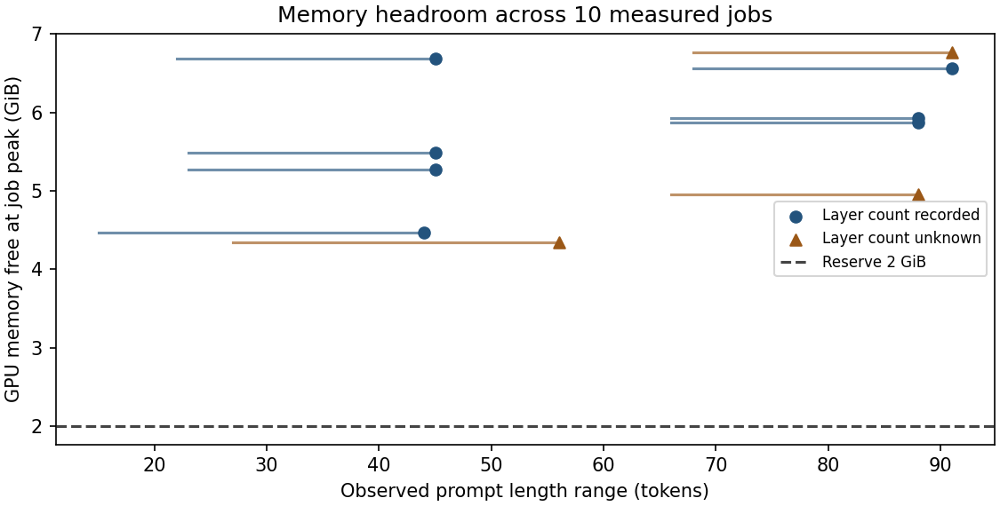

# hardware-fit on raider-wsl

[Setup evidence](../README.md) · [Results index](../../README.md)

## Can the model run here?

| Model and runtime | Job status | Completed | Checks passed | Prompt tokens observed | Time until text appears (median s) | Placement evidence | Source |
|---|---|---:|---:|---:|---:|---|---|
| inkling2-mini-26b-iq4_nl · LM Studio | succeeded | 27/27 | 27/27 | 27–56 | 1.72 | fit inferred from device memory, layer count unknown | [Report](../../../hardware-fit/campaign-20261124T232244Z-86c68e03-fit-hardware-fit-1/README.md) |
| muse-glimmer-30b-kquant-17gb-q4_k_m · LM Studio | succeeded | 27/27 | 24/27 | 68–91 | 4.13 | fit inferred from device memory, layer count unknown | [Report](../../../hardware-fit/campaign-20261124T232244Z-86c68e03-fit-hardware-fit-1/README.md) |
| inkling2-mini-26b-iq4_nl · Ollama | failed | 0/27 | 0/27 | not recorded | not recorded | failed before any request completed | [Report](../../../hardware-fit/campaign-20261124T230811Z-0fa376ca-fit-hardware-fit-1/README.md) |
| muse-glimmer-30b-kquant-17gb-q4_k_m · Ollama | succeeded | 27/27 | 24/27 | 68–91 | 4.05 | 53 of 53 layers reported on GPU | [Report](../../../hardware-fit/campaign-20261124T230811Z-0fa376ca-fit-hardware-fit-1/README.md) |
| qwen38-27b-ud-q4_k_xl · Ollama | succeeded | 27/27 | 24/27 | 66–88 | 1.87 | 66 of 66 layers reported on GPU | [Report](../../../hardware-fit/campaign-20261124T230811Z-0fa376ca-fit-hardware-fit-1/README.md) |
| inkling2-mini-26b-iq4_nl · KoboldCpp | succeeded | 27/27 | 27/27 | 15–44 | 6.48 | 49 of 49 layers reported on GPU | [Report](../../../hardware-fit/campaign-20261124T225210Z-e801df32-fit-hardware-fit-1/README.md) |
| muse-glimmer-30b-kquant-17gb-q4_k_m · KoboldCpp | succeeded | 27/27 | 18/27 | 22–45 | 0.524 | 53 of 53 layers reported on GPU | [Report](../../../hardware-fit/campaign-20261124T225210Z-e801df32-fit-hardware-fit-1/README.md) |
| qwen38-27b-ud-q4_k_xl · KoboldCpp | succeeded | 27/27 | 24/27 | 23–45 | 2.96 | 66 of 66 layers reported on GPU | [Report](../../../hardware-fit/campaign-20261124T225210Z-e801df32-fit-hardware-fit-1/README.md) |
| qwen38-27b-ud-q4_k_xl · LM Studio | succeeded | 27/27 | 24/27 | 66–88 | 0.886 | fit inferred from device memory, layer count unknown | [Report](../../../hardware-fit/campaign-20261123T120632Z-53d7833d-fit-hardware-fit-1/README.md) |
| qwen38-27b-ud-q4_k_xl · Ollama | succeeded | 27/27 | 24/27 | 66–88 | 1.88 | 66 of 66 layers reported on GPU | [Report](../../../hardware-fit/campaign-20261123T120632Z-53d7833d-fit-hardware-fit-1/README.md) |
| qwen38-27b-ud-q4_k_xl · KoboldCpp | succeeded | 27/27 | 24/27 | 23–45 | 2.78 | 66 of 66 layers reported on GPU | [Report](../../../hardware-fit/campaign-20261123T060454Z-d3e0de27-fit-hardware-fit-1/README.md) |

## Memory at the tested prompts

Device-wide memory includes other processes. The reserve is the minimum free memory the experiment requests. Each peak covers the whole job, across prompt lengths.

| Date / model / runtime | Prompt tokens observed | Context window requested (tokens) | Peak used / total (MiB) | Reserve (MiB) | Fit verdict |
|---|---:|---:|---:|---:|---|
| 2026-11-24 · inkling2-mini-26b-iq4_nl · lmstudio | 27–56 | 8192 | 20020 / 24463 | 2048 | in_vram |
| 2026-11-24 · muse-glimmer-30b-kquant-17gb-q4_k_m · lmstudio | 68–91 | 8192 | 17532 / 24463 | 2048 | in_vram |
| 2026-11-24 · inkling2-mini-26b-iq4_nl · ollama | not recorded | 8192 | 2126 / 24463 | 2048 | not_in_vram |
| 2026-11-24 · muse-glimmer-30b-kquant-17gb-q4_k_m · ollama | 68–91 | 8192 | 17745 / 24463 | 2048 | in_vram |
| 2026-11-24 · qwen38-27b-ud-q4_k_xl · ollama | 66–88 | 8192 | 18446 / 24463 | 2048 | in_vram |
| 2026-11-24 · inkling2-mini-26b-iq4_nl · koboldcpp | 15–44 | 8192 | 19894 / 24463 | 2048 | in_vram |
| 2026-11-24 · muse-glimmer-30b-kquant-17gb-q4_k_m · koboldcpp | 22–45 | 8192 | 17620 / 24463 | 2048 | in_vram |
| 2026-11-24 · qwen38-27b-ud-q4_k_xl · koboldcpp | 23–45 | 8192 | 18849 / 24463 | 2048 | in_vram |
| 2026-11-23 · qwen38-27b-ud-q4_k_xl · lmstudio | 66–88 | 8192 | 19390 / 24463 | 2048 | in_vram |
| 2026-11-23 · qwen38-27b-ud-q4_k_xl · ollama | 66–88 | 8192 | 18390 / 24463 | 2048 | in_vram |
| 2026-11-23 · qwen38-27b-ud-q4_k_xl · koboldcpp | 23–45 | 8192 | 19071 / 24463 | 2048 | in_vram |



## Matched model comparisons

A group changes the model package within one publication on one hardware configuration and runtime. The suite hashes, exact prompts, measured repetitions, scorer code and recorded request settings must match. The package includes its tokenizer and template. Failed jobs and runs with incomplete controls remain in the run history.

Times are descriptive. Host paging, model-specific defaults, cache reuse and independent sessions can be unobserved. Each row shows this run’s observed median among completed requests. Repeated prompts on one host do not establish uncertainty across machines or general model quality. The downloadable manifest contains each full comparison key and its inputs.

### koboldcpp · 2026-11-24 · 2ab74f59c1bb

Fixed workload and settings include 9 tasks × 3 measured attempts, protocol openai, mode measured and hardware raider-wsl. Backend version: 1.125.1. Comparison question: smoke checks for model packages under the same recorded resource budget.

| Model package | Completed | Checks passed | Wall time (median s) | Time until text appears (median s) | Backend decode (median tok/s) |
|---|---:|---:|---:|---:|---:|
| inkling2-mini-26b-iq4_nl | 27/27 | 27/27 | 6.64 | 6.48 | not recorded |
| muse-glimmer-30b-kquant-17gb-q4_k_m | 27/27 | 18/27 | 0.524 | 0.524 | not recorded |

Paired wall-time differences use inkling2-mini-26b-iq4_nl as the alphabetically first reference. For each identical prompt, subtract the reference median from the other model’s median. The range spans the observed prompts. Negative values mean a shorter wait.

| Model package | Paired prompts | Median difference (s) | Observed range (s) |
|---|---:|---:|---:|
| muse-glimmer-30b-kquant-17gb-q4_k_m | 9 | -6.14 | -12–-3.61 |

### lmstudio · 2026-11-24 · ffa32eb897ed

Fixed workload and settings include 9 tasks × 3 measured attempts, protocol openai, mode measured and hardware raider-wsl. Backend version: 0.4.28+2. Comparison question: smoke checks for model packages under the same recorded resource budget.

| Model package | Completed | Checks passed | Wall time (median s) | Time until text appears (median s) | Backend decode (median tok/s) |
|---|---:|---:|---:|---:|---:|
| inkling2-mini-26b-iq4_nl | 27/27 | 27/27 | 1.75 | 1.72 | not recorded |
| muse-glimmer-30b-kquant-17gb-q4_k_m | 27/27 | 24/27 | 4.16 | 4.13 | not recorded |

Paired wall-time differences use inkling2-mini-26b-iq4_nl as the alphabetically first reference. For each identical prompt, subtract the reference median from the other model’s median. The range spans the observed prompts. Negative values mean a shorter wait.

| Model package | Paired prompts | Median difference (s) | Observed range (s) |
|---|---:|---:|---:|
| muse-glimmer-30b-kquant-17gb-q4_k_m | 9 | 2.17 | -0.514–4.8 |

## Reproduce a run

Choose a dated report in the table. The manifest pins the code revision. Config records the planned job, input hashes and launch settings. CSV contains category summaries. Raw contains the published measurements. Some older bundles omit artifacts or runtime details. Local paths have been removed.

[Read the reproduction recipe](../../../../REPRODUCE.md) · [Download the comparison manifest](hardware-fit.json).

For the newest listed job (inkling2-mini-26b-iq4_nl-lmstudio) run this from the repository root.

```sh
llm-eval result-inputs --input docs/results/hardware-fit/campaign-20261124T232244Z-86c68e03-fit-hardware-fit-1 --job fit-hardware-fit-1-971aedbccee6
```

## Run history

One row per published job, newest first. A completed request can still fail its check. Output-cap and reload conditions can differ between rows. Use a matched group for a controlled comparison. Projection rows count candidate settings. Legal jobs expose aggregate evidence by cohort.

| Date | Model / runtime | Mode and status | Actual workload | Completed | Checks passed | Median wall s | First visible text s | Backend decode tok/s | Evidence |
|---|---|---|---|---:|---:|---:|---:|---:|---|
| 2026-11-24 | inkling2-mini-26b-iq4_nl · lmstudio | measured · succeeded | 9 tasks × 3 measured attempts | 27/27 | 27/27 | 1.75 | 1.72 | not recorded | [Report](../../../hardware-fit/campaign-20261124T232244Z-86c68e03-fit-hardware-fit-1/README.md) · [Config](../../../hardware-fit/campaign-20261124T232244Z-86c68e03-fit-hardware-fit-1/resolved-config.json) · [Manifest](../../../hardware-fit/campaign-20261124T232244Z-86c68e03-fit-hardware-fit-1/manifest.json) · [CSV](../../../hardware-fit/campaign-20261124T232244Z-86c68e03-fit-hardware-fit-1/summary.csv) · [Raw](../../../hardware-fit/campaign-20261124T232244Z-86c68e03-fit-hardware-fit-1/raw/measurements.jsonl.gz) |
| 2026-11-24 | muse-glimmer-30b-kquant-17gb-q4_k_m · lmstudio | measured · succeeded | 9 tasks × 3 measured attempts | 27/27 | 24/27 | 4.16 | 4.13 | not recorded | [Report](../../../hardware-fit/campaign-20261124T232244Z-86c68e03-fit-hardware-fit-1/README.md) · [Config](../../../hardware-fit/campaign-20261124T232244Z-86c68e03-fit-hardware-fit-1/resolved-config.json) · [Manifest](../../../hardware-fit/campaign-20261124T232244Z-86c68e03-fit-hardware-fit-1/manifest.json) · [CSV](../../../hardware-fit/campaign-20261124T232244Z-86c68e03-fit-hardware-fit-1/summary.csv) · [Raw](../../../hardware-fit/campaign-20261124T232244Z-86c68e03-fit-hardware-fit-1/raw/measurements.jsonl.gz) |
| 2026-11-24 | inkling2-mini-26b-iq4_nl · ollama | measured · failed | 9 tasks × 3 measured attempts | 0/27 | 0/27 | not recorded | not recorded | not recorded | [Report](../../../hardware-fit/campaign-20261124T230811Z-0fa376ca-fit-hardware-fit-1/README.md) · [Config](../../../hardware-fit/campaign-20261124T230811Z-0fa376ca-fit-hardware-fit-1/resolved-config.json) · [Manifest](../../../hardware-fit/campaign-20261124T230811Z-0fa376ca-fit-hardware-fit-1/manifest.json) · [CSV](../../../hardware-fit/campaign-20261124T230811Z-0fa376ca-fit-hardware-fit-1/summary.csv) · [Raw](../../../hardware-fit/campaign-20261124T230811Z-0fa376ca-fit-hardware-fit-1/raw/measurements.jsonl.gz) |
| 2026-11-24 | muse-glimmer-30b-kquant-17gb-q4_k_m · ollama | measured · succeeded | 9 tasks × 3 measured attempts | 27/27 | 24/27 | 4.07 | 4.05 | 37.9 | [Report](../../../hardware-fit/campaign-20261124T230811Z-0fa376ca-fit-hardware-fit-1/README.md) · [Config](../../../hardware-fit/campaign-20261124T230811Z-0fa376ca-fit-hardware-fit-1/resolved-config.json) · [Manifest](../../../hardware-fit/campaign-20261124T230811Z-0fa376ca-fit-hardware-fit-1/manifest.json) · [CSV](../../../hardware-fit/campaign-20261124T230811Z-0fa376ca-fit-hardware-fit-1/summary.csv) · [Raw](../../../hardware-fit/campaign-20261124T230811Z-0fa376ca-fit-hardware-fit-1/raw/measurements.jsonl.gz) |
| 2026-11-24 | qwen38-27b-ud-q4_k_xl · ollama | measured · succeeded | 9 tasks × 3 measured attempts | 27/27 | 24/27 | 1.97 | 1.87 | 35.8 | [Report](../../../hardware-fit/campaign-20261124T230811Z-0fa376ca-fit-hardware-fit-1/README.md) · [Config](../../../hardware-fit/campaign-20261124T230811Z-0fa376ca-fit-hardware-fit-1/resolved-config.json) · [Manifest](../../../hardware-fit/campaign-20261124T230811Z-0fa376ca-fit-hardware-fit-1/manifest.json) · [CSV](../../../hardware-fit/campaign-20261124T230811Z-0fa376ca-fit-hardware-fit-1/summary.csv) · [Raw](../../../hardware-fit/campaign-20261124T230811Z-0fa376ca-fit-hardware-fit-1/raw/measurements.jsonl.gz) |
| 2026-11-24 | inkling2-mini-26b-iq4_nl · koboldcpp | measured · succeeded | 9 tasks × 3 measured attempts | 27/27 | 27/27 | 6.64 | 6.48 | not recorded | [Report](../../../hardware-fit/campaign-20261124T225210Z-e801df32-fit-hardware-fit-1/README.md) · [Config](../../../hardware-fit/campaign-20261124T225210Z-e801df32-fit-hardware-fit-1/resolved-config.json) · [Manifest](../../../hardware-fit/campaign-20261124T225210Z-e801df32-fit-hardware-fit-1/manifest.json) · [CSV](../../../hardware-fit/campaign-20261124T225210Z-e801df32-fit-hardware-fit-1/summary.csv) · [Raw](../../../hardware-fit/campaign-20261124T225210Z-e801df32-fit-hardware-fit-1/raw/measurements.jsonl.gz) |
| 2026-11-24 | muse-glimmer-30b-kquant-17gb-q4_k_m · koboldcpp | measured · succeeded | 9 tasks × 3 measured attempts | 27/27 | 18/27 | 0.524 | 0.524 | not recorded | [Report](../../../hardware-fit/campaign-20261124T225210Z-e801df32-fit-hardware-fit-1/README.md) · [Config](../../../hardware-fit/campaign-20261124T225210Z-e801df32-fit-hardware-fit-1/resolved-config.json) · [Manifest](../../../hardware-fit/campaign-20261124T225210Z-e801df32-fit-hardware-fit-1/manifest.json) · [CSV](../../../hardware-fit/campaign-20261124T225210Z-e801df32-fit-hardware-fit-1/summary.csv) · [Raw](../../../hardware-fit/campaign-20261124T225210Z-e801df32-fit-hardware-fit-1/raw/measurements.jsonl.gz) |
| 2026-11-24 | qwen38-27b-ud-q4_k_xl · koboldcpp | measured · succeeded | 9 tasks × 3 measured attempts | 27/27 | 24/27 | 3.04 | 2.96 | not recorded | [Report](../../../hardware-fit/campaign-20261124T225210Z-e801df32-fit-hardware-fit-1/README.md) · [Config](../../../hardware-fit/campaign-20261124T225210Z-e801df32-fit-hardware-fit-1/resolved-config.json) · [Manifest](../../../hardware-fit/campaign-20261124T225210Z-e801df32-fit-hardware-fit-1/manifest.json) · [CSV](../../../hardware-fit/campaign-20261124T225210Z-e801df32-fit-hardware-fit-1/summary.csv) · [Raw](../../../hardware-fit/campaign-20261124T225210Z-e801df32-fit-hardware-fit-1/raw/measurements.jsonl.gz) |
| 2026-11-23 | qwen38-27b-ud-q4_k_xl · lmstudio | measured · succeeded | 9 tasks × 3 measured attempts | 27/27 | 24/27 | 0.886 | 0.886 | not recorded | [Report](../../../hardware-fit/campaign-20261123T120632Z-53d7833d-fit-hardware-fit-1/README.md) · [Config](../../../hardware-fit/campaign-20261123T120632Z-53d7833d-fit-hardware-fit-1/resolved-config.json) · [Manifest](../../../hardware-fit/campaign-20261123T120632Z-53d7833d-fit-hardware-fit-1/manifest.json) · [CSV](../../../hardware-fit/campaign-20261123T120632Z-53d7833d-fit-hardware-fit-1/summary.csv) · [Raw](../../../hardware-fit/campaign-20261123T120632Z-53d7833d-fit-hardware-fit-1/raw/measurements.jsonl.gz) |
| 2026-11-23 | qwen38-27b-ud-q4_k_xl · ollama | measured · succeeded | 9 tasks × 3 measured attempts | 27/27 | 24/27 | 1.97 | 1.88 | 35.5 | [Report](../../../hardware-fit/campaign-20261123T120632Z-53d7833d-fit-hardware-fit-1/README.md) · [Config](../../../hardware-fit/campaign-20261123T120632Z-53d7833d-fit-hardware-fit-1/resolved-config.json) · [Manifest](../../../hardware-fit/campaign-20261123T120632Z-53d7833d-fit-hardware-fit-1/manifest.json) · [CSV](../../../hardware-fit/campaign-20261123T120632Z-53d7833d-fit-hardware-fit-1/summary.csv) · [Raw](../../../hardware-fit/campaign-20261123T120632Z-53d7833d-fit-hardware-fit-1/raw/measurements.jsonl.gz) |
| 2026-11-23 | qwen38-27b-ud-q4_k_xl · koboldcpp | measured · succeeded | 9 tasks × 3 measured attempts | 27/27 | 24/27 | 2.83 | 2.78 | not recorded | [Report](../../../hardware-fit/campaign-20261123T060454Z-d3e0de27-fit-hardware-fit-1/README.md) · [Config](../../../hardware-fit/campaign-20261123T060454Z-d3e0de27-fit-hardware-fit-1/resolved-config.json) · [Manifest](../../../hardware-fit/campaign-20261123T060454Z-d3e0de27-fit-hardware-fit-1/manifest.json) · [CSV](../../../hardware-fit/campaign-20261123T060454Z-d3e0de27-fit-hardware-fit-1/summary.csv) · [Raw](../../../hardware-fit/campaign-20261123T060454Z-d3e0de27-fit-hardware-fit-1/raw/measurements.jsonl.gz) |
| 2026-11-23 | measured-models-gguf · projection | projection · succeeded | capacity estimates | no model call | unscored | not recorded | not recorded | not recorded | [Report](../../../hardware-fit/campaign-20261123T060120Z-252fece8-fit-hardware-fit-1/README.md) · [Config](../../../hardware-fit/campaign-20261123T060120Z-252fece8-fit-hardware-fit-1/resolved-config.json) · [Manifest](../../../hardware-fit/campaign-20261123T060120Z-252fece8-fit-hardware-fit-1/manifest.json) · [CSV](../../../hardware-fit/campaign-20261123T060120Z-252fece8-fit-hardware-fit-1/summary.csv) · [Raw](../../../hardware-fit/campaign-20261123T060120Z-252fece8-fit-hardware-fit-1/raw/measurements.jsonl.gz) |
| 2026-11-23 | measured-models-gguf-as-found · projection | projection · succeeded | capacity estimates | no model call | unscored | not recorded | not recorded | not recorded | [Report](../../../hardware-fit/campaign-20261123T060120Z-252fece8-fit-hardware-fit-1/README.md) · [Config](../../../hardware-fit/campaign-20261123T060120Z-252fece8-fit-hardware-fit-1/resolved-config.json) · [Manifest](../../../hardware-fit/campaign-20261123T060120Z-252fece8-fit-hardware-fit-1/manifest.json) · [CSV](../../../hardware-fit/campaign-20261123T060120Z-252fece8-fit-hardware-fit-1/summary.csv) · [Raw](../../../hardware-fit/campaign-20261123T060120Z-252fece8-fit-hardware-fit-1/raw/measurements.jsonl.gz) |
