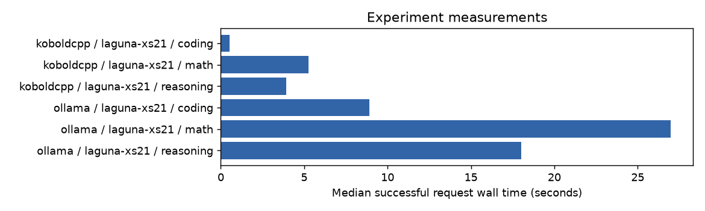

# model-offloading results

Status: **complete**. Synthetic fixtures: **false**.

Campaign: `matrix-wsl-laguna-xs21`. Experiment run: `offload-model-offloading-1`. Measured code: `7e4606827cde8d9af4ccbb0c2ec8473d8d8049ce`.

[Raw measurements](raw/measurements.jsonl.gz) · [JSON summary](summary.json) · [CSV summary](summary.csv) · [Manifest](manifest.json) · [Resolved configuration](resolved-config.json)

## Configuration coverage

| Case | Hardware | OS | Harness | Model | Status |
|---|---|---|---|---|---|
| laguna-xs21-koboldcpp | raider-wsl | windows-11-wsl2-ubuntu-26.04 | koboldcpp | laguna-xs21 | succeeded |
| laguna-xs21-ollama | raider-wsl | windows-11-wsl2-ubuntu-26.04 | ollama | laguna-xs21 | succeeded |

## Measurements by harness and model

| Harness | Model | Category | Requests | Errors or missing | Quality passes | Decision accuracy | Median seconds | Output tokens/s | Job |
|---|---|---|---:|---:|---:|---:|---:|---:|---|
| koboldcpp | laguna-xs21 | coding | 9 | 0 | 3/9 | unavailable | 0.5306 | 11.34 | `29fef6a4c03e` |
| koboldcpp | laguna-xs21 | math | 9 | 0 | 0/9 | unavailable | 5.249 | 25.87 | `29fef6a4c03e` |
| koboldcpp | laguna-xs21 | reasoning | 9 | 0 | 0/9 | unavailable | 3.925 | 22.42 | `29fef6a4c03e` |
| ollama | laguna-xs21 | coding | 9 | 0 | 9/9 | unavailable | 8.925 | 29.81 | `e08cf58f281b` |
| ollama | laguna-xs21 | math | 9 | 0 | 9/9 | unavailable | 26.98 | 29.43 | `e08cf58f281b` |
| ollama | laguna-xs21 | reasoning | 9 | 0 | 3/9 | unavailable | 18.02 | 29.85 | `e08cf58f281b` |

## Interpretation and reproduction

Warmups and superseded attempts remain in raw data and are excluded from summaries. Each job/category is a separate cohort. Missing values remain unknown. Replay cost and generation latency are estimates; an offline oracle is an upper bound. LiveBench upstream grades are exported separately as judgment and benchmark summary records, not relabeled as local smoke scores.

Use the measured code revision and resolved configuration to reconstruct the campaign with your local artifact paths and credential references. Verify the recorded input hashes. Run `llm-eval plan --campaign YOUR_CAMPAIGN.json` before `llm-eval run --campaign YOUR_CAMPAIGN.json`. Synthetic results do not establish model quality or hardware performance.
